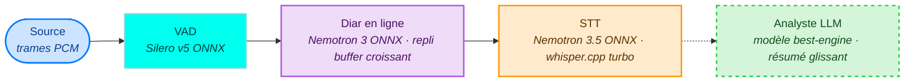
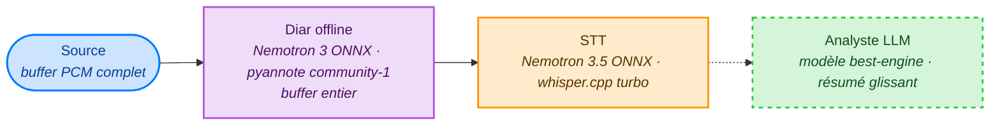
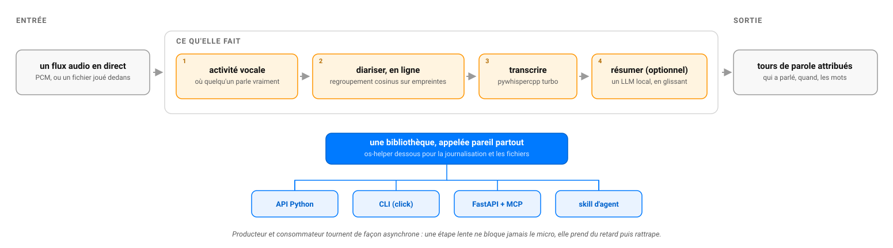

# Vocal Helper

[🇫🇷](https://github.com/warith-harchaoui/vocal-helper/blob/main/LISEZMOI.md) · [🇬🇧](https://github.com/warith-harchaoui/vocal-helper/blob/main/README.md)

[](https://github.com/warith-harchaoui/vocal-helper/actions/workflows/ci.yml)
[](https://github.com/warith-harchaoui/vocal-helper/blob/main/LICENSE)
[](#)
[](https://github.com/astral-sh/ruff)
[](https://github.com/warith-harchaoui/vocal-helper/blob/main/.github/PULL_REQUEST_TEMPLATE.md)
[](#la-promesse)

`Vocal Helper` fait partie de la collection `AI Helpers` : des bibliothèques Python pensées pour bâtir des outils d'intelligence artificielle.

[](https://deraison.ai/ai-helpers)

[🌍 AI Helpers](https://deraison.ai/ai-helpers)

## La promesse

**Local d'abord, par conception.** vocal-helper tourne entièrement sur votre machine. Trois étapes, toutes locales :

- **la transcription** — mettre la parole en texte (Nemotron 3.5 en ONNX quand la langue est à découvrir, whisper.cpp quand elle est donnée) ;
- **la diarisation** — déterminer qui, parmi plusieurs locuteurs possibles, a dit quel passage, en les étiquetant `S0`, `S1`, ainsi de suite (Nemotron 3 en ONNX par défaut, pyannote / NeMo / sherpa-onnx sur demande) ;
- **le résumé** — un résumé glissant optionnel, produit par un modèle Ollama local.

Votre audio comme vos transcriptions ne partent jamais vers un service tiers : aucune télémétrie, aucun compte, aucun verrouillage propriétaire. Les modes payants hébergés (Gladia ou ElevenLabs Scribe pour les mots, pyannoteAI pour les locuteurs, par l'extra `[cloud]`) existent pour qui les demande par leur nom avec une clé ; sans clé ils sont indisponibles et le routeur n'en choisit jamais un.

Cela compte ici plus que presque partout ailleurs dans la suite. Votre voix, comme celle de toutes les personnes enregistrées, figure parmi les données les plus personnelles qui soient ; une transcription est le compte rendu mot pour mot de ce qui a été dit et par qui. Garder les deux sur votre propre matériel, c'est ce qui rend l'outil sûr à pointer sur une vraie réunion, un entretien, une séance.

Fait partie de la suite [AI Helpers](https://github.com/warith-harchaoui/ai-helpers) : la souveraineté sur vos données par l'Open Source local d'abord.

Vocal Helper transforme un flux audio PCM (modulation d'impulsions codées) en énoncés diarisés puis transcrits, avec en option un résumé glissant produit par un LLM (grand modèle de langue).

En interne, c'est un **pipeline producteur/consommateur**. Chaque étape de traitement — détecter la parole, identifier le locuteur, transcrire, résumer — tourne comme un poste de travail séparé, puis chaque poste transmet son résultat au suivant par une file d'attente. Comme une chaîne de boulangerie : la pâte passe du pétrin au four puis au refroidissement, chaque poste traitant un lot différent en même temps plutôt que d'attendre, inactif, que toute la commande soit finie.

Deux chemins sont livrés :

- **Online** (`voh.Pipeline`) : flux PCM vivant → transcription en direct + résumé en direct. Chaque étage tourne à sa propre cadence, découplé par des files bornées. L'étage STT (transcription de la parole) se préchauffe au démarrage pour que le premier sous-titre n'attende pas l'inférence à froid de whisper.
  - **La diarisation** passe par défaut par Nemotron 3 Diarization, via son graphe ONNX — sans torch, sans HuggingFace, poids dans le bundle diarization-engines — avec repli sur la re-diarisation à buffer croissant quand ce graphe manque. Voir [Diarisation en direct : ce qui a changé](#diarisation-en-direct--ce-qui-a-changé).
- **Offline** (`voh.OfflinePipeline`) : buffer audio complet → diarisation de la meilleure qualité possible → transcription en lot à plein régime → résumé.
  - **La diarisation** traite la réunion entière en un seul appel : Nemotron 3 ONNX quand son graphe est dans le bundle, sinon pyannote community-1 / NeMo Sortformer / sherpa dans l'ordre de qualité mesurée (`backend="auto"`). L'étude map-reduce offline du 2026-07-14 a trouvé le buffer entier strictement meilleur en DER (taux d'erreur de diarisation) ; le découpage-recollage ne survit que comme garde-fou mémoire au-delà de ~1 h.
  - **La transcription** passe par le moteur que choisit `asr={"engine": "auto"}` (voir la ligne STT plus bas). Côté whisper, elle concatène les segments consécutifs en appels de ≤ 24 s : RTF ~6,5× plus bas pour un WER meilleur, selon le balayage du 2026-07-09. `OfflinePipelineConfig(asr={"batch": False})` redonne l'ASR segment par segment.

Vocal Helper est éprouvé en production. Le paquet est publié sur [PyPI](https://pypi.org/project/vocal-helper/) sous des tags versionnés selon le [versionnage sémantique](https://semver.org/lang/fr/) (actuellement `v4.0.0`) ; l'intégration continue (CI, une chaîne automatisée qui fait tourner les tests puis le linter à chaque envoi) reste au vert sur `main` avant toute publication d'un tag.

Il occupe le sommet du graphe de dépendances de la suite AI Helpers — le paquet le plus complet et le plus lourd — en s'appuyant sur cinq sœurs :

| Sœur | Ce qu'elle apporte ici |
|---|---|
| [os-helper](https://github.com/warith-harchaoui/os-helper) | la journalisation et la gestion des fichiers partagées |
| [best-engine-ai-helper](https://github.com/warith-harchaoui/best-engine-ai-helper) | le choix du modèle de langue décrit plus bas |
| [audio-helper](https://github.com/warith-harchaoui/audio-helper) | le décodage indépendant du format |
| [capture-helper](https://github.com/warith-harchaoui/capture-helper) | la source micro en direct |
| [podcast-helper](https://github.com/warith-harchaoui/podcast-helper) | toute URL qu'un navigateur saurait ouvrir |

Chacune de ces cinq bibliothèques doit fonctionner correctement pour qu'une seule transcription sorte juste, ce qui fait de ce paquet le test d'intégration le plus exigeant de la suite au quotidien.

## Documentation

[💻 Documentation](https://deraison.ai/ai-helpers/docs/vocal-helper-doc/)

[🗺️ Paysage](https://github.com/warith-harchaoui/vocal-helper/blob/main/PAYSAGE.md)

[📋 Exemples](https://github.com/warith-harchaoui/vocal-helper/blob/main/EXEMPLES.md)

## Pipeline

Toutes les frontières entre étages sont des `asyncio.Queue` bornées ;
chaque étage est sa propre coroutine. Les couleurs suivent la
[palette AI Helpers](https://deraison.ai/colors/).

### Online (streaming)



L'arête pointillée indique que l'analyste LLM est optionnel
(`llm=None` le désactive).

### Offline (batch)



Pas de VAD dans le chemin offline : la diarisation absorbe le buffer
complet et fait sa propre segmentation.

| Étage | Modèle | Notes |
|---|---|---|
| **VAD** (détection d'activité vocale) | Silero v5 ONNX (CPU, processeur central) | Fenêtre 32 ms, `activity_threshold=0.5`, `min_silence_ms=300` par défaut. |
| **Diarisation (online)** | Nemotron 3 ONNX quand son graphe est dans le bundle, sinon la re-diarisation à buffer croissant par-dessus le clusterer par segment (voir [Diarisation en direct](#diarisation-en-direct--ce-qui-a-changé)). L'embedder du clusterer : `nvidia/titanet_large` (NeMo), `pyannote/embedding` ou `sherpa` (TitaNet ONNX sans torch), `backend="auto"` prenant le meilleur installé | Le clusterer par segment : embedding + clustering moyenne-mobile par distance cosinus, `join_threshold=0.50`. Monté de 0,30 à **0,50** quand TitaNet est devenu l'embedder par défaut : il vit sur une autre échelle de cosinus ; un rejeu sur 8 réunions AMI trouvait 87 locuteurs à 0,30 là où il y en a 4, contre 28 à 0,50, pour une confusion médiane de 0,234 contre 0,095. Le défaut est passé à NeMo au balayage d'embedders du 2026-06-30 (`studies/diar_embedding_backend.py`) : TitaNet gagne **+76 % de marge de séparabilité** (cosinus médian inter − intra = 0,354 contre 0,201 pour pyannote/embedding) sur AMI dev-slice, pour 7× de latence par appel (45 ms contre 6 ms, négligeable par segment voisé). `backend='pyannote'` évite les ~5 Go d'installation NeMo, `backend='sherpa'` le chemin sans torch. |
| **Diarisation (offline)** | `nemotron` (Nemotron 3 ONNX, sans torch, défaut quand son graphe est dans le bundle), `pyannote` **community-1**, `nvidia/diar_sortformer_v1` (NeMo) ou `sherpa` (sans torch) | `backend="auto"` prend le premier installé dans `OFFLINE_PREFERENCE` (nemotron, pyannote, nemo, sherpa). Appel sur le buffer entier. Au-delà de `ideal_duration_s` (**3600 s** pour pyannote, soit le buffer entier en pratique, le découpage n'étant qu'un garde-fou mémoire ; **60 s** pour NeMo, imposé par le plafond Sortformer de 90 s) l'audio est découpé avec 10 s de recouvrement puis recollé par AHC cosinus à `stitch_threshold=0.35`. L'étude map-reduce offline du 2026-07-14 a trouvé le buffer entier strictement meilleur en DER (0,143 contre 0,170 à 300 s). `sherpa` regroupe lui-même le buffer entier, donc `stitch_threshold` n'a aucun effet sur lui ; son regroupement se règle par `sherpa_cluster_threshold` (défaut `0.5`, calé sur AMI propre) et `sherpa_num_clusters` (défaut `-1`, automatique), tous deux exposés depuis la **v0.7.0**. Le défaut `0.5` sur-segmente la téléphonie bruitée à deux voix en dizaines de locuteurs : posez `sherpa_num_clusters=2` quand le compte est connu (voir `doc/studies/diar-study.md` §12 dans `pasdebonneoudemauvaisesituation`). **Le backend retenu est décidé par le [routeur](#routeur-de-backend--laiguilleur).** |
| **STT** (transcription de la parole) | `engine="auto"` (défaut) : **Nemotron 3.5** (encodeur + tête CTC en ONNX, hôte numpy, sans torch) quand la langue est à découvrir ; [`pywhispercpp`](https://github.com/abdeladim-s/pywhispercpp) turbo dès qu'une `language`, un `initial_prompt` ou un `model` whisper non défaut est donné (`voh.pipeline.choose_asr_engine`) | Taux d'erreur sur les mots, Nemotron int8 contre whisper `auto`, hors ligne : AMI 0,23 / 0,38, voix mêlées 0,38 / 0,54, Common Voice français 0,27 / 0,69 ; en direct segment par segment, télévision française 0,48 / 0,83. À qui l'on donne la langue, whisper gagne sur la télévision française comme en anglais lu, d'où la règle. Le graphe int8 de Nemotron (669 Mo) se télécharge une fois depuis `deraison.ai/nemotron-onnx`, vérifié contre un sha256 épinglé (`VH_NEMOTRON_ASR_URL` pour un miroir, `VH_NEMOTRON_ASR_GRAPH` pour un fichier local). `engine="whisper"` / `--asr-engine whisper` rend l'ancien chemin. Côté whisper : `large-v3-turbo-q5_0` par défaut ; avec `language="auto"` la langue est détectée sur 30 s prises au milieu du buffer avant que whisper tourne. Timestamps mots activés. Exécution en thread pool pour ne jamais bloquer la boucle async. **Fortement recommandé : fournir `initial_prompt` (biais de domaine)**, qui retire 15 à 25 points de WER et jusqu'à 39 % de RTF selon le balayage du 2026-06-30 (`studies/whisper_prompt_lang_lock.py`). |
| **Analyste LLM** *(optionnel à l'exécution : `llm=None` le désactive)* | Modèle résolu via **best-engine-ai-helper** depuis le brief versionné `vocal_helper/llm.brief.yaml`, servi par Ollama ou vLLM | Résumé glissant de tout ce qui est **plus vieux que 60 s**. La fenêtre récente de 60 s reste verbatim et le résumé se rafraîchit tous les **60 s de contenu évincé** (`flush_every_s=60`). Aucun tag de modèle n'est codé en dur : `best-engine-ai-helper` résout le brief en un `llm.engine.yaml` spécifique à la machine (gitignoré) qui nomme le backend + le modèle et chaque requête passe par `best_engine_ai_helper.llm.chat`. Le balayage historique de 7 modèles du 2026-06-30 (`studies/llm_model_size_sweep.py`), qui faisait ressortir de petits modèles à RTF bas comme `gemma3:4b` / `qwen2.5:3b`, avec `gemma4:12b-mlx` pour la qualité offline, nourrit désormais les réglages `min_tps` / `headroom` du brief plutôt qu'un tag épinglé. |

## Comment ça marche



## Installation

> **Plus de recettes ?** Voir [`EXEMPLES.md`](https://github.com/warith-harchaoui/vocal-helper/blob/main/EXEMPLES.md)
> pour un livre de recettes autonome et copiable des cas courants
> (micro en direct, rejeu d'URL, lot offline, abonnés, bibliothèque + CLI).

> **Déploiement sur un serveur GPU (processeur graphique) ?** Voir [TECHNICAL_STACK.md](https://github.com/warith-harchaoui/vocal-helper/blob/main/TECHNICAL_STACK.md)
> pour la recette complète : CUDA + PyTorch, whisper.cpp compilé avec
> `GGML_CUDA=on`, pyannote 3.1 sur MPS/CUDA, service systemd Ollama,
> RTF (facteur temps réel) attendus par GPU et un manifest
> d'installation reproductible en 10 étapes couvrant toute la suite
> AI Helpers (os-helper, audio-helper, podcast-helper, youtube-helper,
> vocal-helper).

**Prérequis** : **Python 3.10–3.13** et **git**, **ffmpeg**, **PortAudio**, multiplateforme :

- 🍎 **macOS** ([Homebrew](https://brew.sh)) : `brew install python git ffmpeg portaudio`
- 🐧 **Ubuntu/Debian** : `sudo apt update && sudo apt install -y python3 python3-pip git ffmpeg portaudio19-dev`
- 🪟 **Windows** (PowerShell) : `winget install Python.Python.3.12 Git.Git Gyan.FFmpeg` (PortAudio est inclus dans les wheels Python)

Nous recommandons d'utiliser des environnements Python. Consultez ce lien si vous ne savez pas en configurer un : [🥸 Tech tips](https://deraison.ai/4ml/#install).

> **Aucun compilateur pour l'installation de base.** Le cœur (`vocal-helper`,
> sans extra) ne tire que des **wheels précompilées** sur toutes les plateformes
> courantes : `pywhispercpp` en publie pour macOS arm64, Linux x86_64/aarch64 et
> Windows (cp39–cp314), donc rien ne compile. Les pièces lourdes sont
> **optionnelles** : l'extra `[nemo]` apporte ~5 Go de PyTorch. Deux
> téléchargements ont lieu à la première utilisation plutôt qu'à l'installation :
> le bundle diarization-engines (voir *Poids des modèles* plus bas) puis le graphe
> ASR Nemotron 3.5 de 669 Mo. Installation de base = bibliothèque + CLI + ASR/VAD +
> diarisation (sherpa-onnx, onnxruntime : sans torch) + analyste LLM.

### Depuis PyPI (recommandé)

```bash
pip install 'vocal-helper[all]'
```

### Depuis les sources (sans PyPI)

```bash
git clone https://github.com/warith-harchaoui/vocal-helper.git
cd vocal-helper
pip install -e ".[all]"
```

L'extra `[all]` installe les sources micro et stream, les backends de diarisation à torch (NeMo, pyannote), la vérification croisée de langue et les clients cloud payants (éteints tant qu'aucune clé n'est posée). À la carte si tout n'est pas nécessaire :

| Extra | Apporte | Requis si |
|---|---|---|
| (aucun) | `os-helper>=4.1`, `best-engine-ai-helper`, `audio-helper`, `numpy`, `scipy`, `silero-vad`, `pywhispercpp`, `sherpa-onnx`, `onnxruntime` | Sources fichier / numpy, VAD, les deux moteurs ASR (whisper.cpp, Nemotron 3.5 ONNX), la diarisation sans torch (Nemotron 3 ONNX, sherpa) et l'analyste LLM font tous partie de l'installation de base |
| `[mic]` | `capture-helper` | Entrée microphone live |
| `[stream]` | `podcast-helper` | Source URL (YouTube, Vimeo, Twitch, flux RSS de podcast) |
| `[pyannote]` | `pyannote.audio` | `diar={'backend': 'pyannote'}` (repli plus léger, ~500 Mo) |
| `[nemo]` | `torch`, `nemo-toolkit[asr]` | `diar={'backend': 'nemo'}` : l'embedder TitaNet et Sortformer, ~5 Go d'installation |
| `[sherpa]` | plus rien | gardé pour que `vocal-helper[sherpa]` se résolve encore : sherpa-onnx est désormais une dépendance cœur |
| `[cloud]` | `requests`, `websockets`, `pyannoteai`, `wallet-helper` | Les modes payants (`voh.CloudOfflinePipeline`, `voh.CloudLivePipeline`, `diar={'backend': 'pyannoteai'}`) ; chacun exige sa clé (`GLADIA_API_KEY`, `ELEVENLABS_API_KEY`, `PYANNOTEAI_API_KEY`, voir `voh.credentials_status()`) ; `wallet-helper` fait qu'un appel facturé ne se paie qu'une fois |
| `[llm]` | `best-engine-ai-helper` (déjà une dépendance cœur ; cet extra ne fait que la relister par intention) | Aucune installation séparée nécessaire, l'analyste LLM est déjà dans l'installation de base |
| `[lid]` | `speechbrain`, `torchaudio` | `voh.lid.cross_check_regions(...)`, une vérification croisée indépendante de la langue |
| `[api]` / `[mcp]` | FastAPI + uvicorn, fastapi-mcp | La surface HTTP et la surface MCP (voir le tableau des surfaces plus bas). Le CLI ne demande aucun extra : `click` est une dépendance cœur |
| `[all]` | Tous les extras ci-dessus sauf `[studies]` | Installation en une ligne |

L'analyste LLM est déjà dans l'installation de base, mais il faut tout de même
résoudre l'engine une fois par machine avant que son backend de service ne
soit prêt. `best-engine-ai-helper` lit le brief versionné
`vocal_helper/llm.brief.yaml`, choisit le backend + le modèle pour votre matériel
(Ollama sur macOS / CPU, vLLM sur GPU discret) et écrit un
`vocal_helper/llm.engine.yaml` gitignoré. `voh.resolve_engine()` le fait à la
première utilisation ou explicitement :

```bash
# Depuis le dossier du paquet vocal_helper (qui contient llm.brief.yaml) :
best-engine-ai-helper resolve --brief llm.brief.yaml --out llm.engine.yaml
ollama serve   # la ligne `serve:` de l'engine nomme le `ollama pull …` exact
```

### Poids des modèles : aucun HuggingFace requis

Tous les poids sont fournis dans un **bundle diarization-engines**
auto-hébergé (le graphe de diarisation Nemotron 3, pyannote community-1 et 3.1
offline, NeMo Sortformer, l'embedder online `pyannote/embedding`, SpeechBrain
VoxLingua107 et le `sherpa` ONNX sans PyTorch, segmentation pyannote-3.0 +
TitaNet). Seule exception, le graphe ASR de Nemotron 3.5 se télécharge à part
depuis `deraison.ai/nemotron-onnx`. On pointe `vocal-helper`
dessus une fois et toute la chaîne tourne **sans HuggingFace** : aucun
token, aucun téléchargement gated, compatible `HF_HUB_OFFLINE=1`.

La configuration tient dans `settings.yaml` (seule config nécessaire) :

```bash
cp settings.yaml.example settings.yaml
# settings.yaml contient déjà :
#   engines:
#     diarization_url: https://deraison.ai/diarization-engines-slim.zip
# settings.yaml est gitignoré.
```

#### Ce que contient l'URL

`https://deraison.ai/diarization-engines-slim.zip` est un **ZIP auto-hébergé**
(~800 Mo) qui miroite chaque modèle gated ou hébergé sur un hub dont la chaîne a
besoin, pour que le projet n'ait jamais à s'authentifier auprès de HuggingFace.
Le code y lit ces dossiers :

| Dossier | Poids | Utilisé par |
|---|---|---|
| `nemotron3/` | `nemotron-3-diarization.onnx` (~400 Mo) | diarisation, offline comme en direct — le défaut dès qu'il est présent |
| `pyannote-community-1/` | le dossier du checkpoint community-1 avec son propre `config.yaml` | diarisation offline — le défaut que le code cherche d'abord |
| `pyannote-3.1/` | segmentation-3.0 + wespeaker `.bin` + un `config.yaml` local | diarisation offline — le repli, signalé par un avertissement, quand le bundle configuré est antérieur à community-1 |
| `nemo-sortformer/` | `diar_sortformer_4spk-v1.nemo` | diarisation offline (NeMo) |
| `pyannote-embedding/` | embedding `.bin` | diarisation online |
| `sherpa/` | segmentation pyannote-3.0 + TitaNet en ONNX | le backend `sherpa` sans torch |
| `speechbrain-voxlingua107/` | instantané ECAPA VoxLingua107 | vérification croisée de la langue |
| `manifest.json` | sha256 + tailles | contrôle d'intégrité au téléchargement |

**Le ZIP publié ne porte ni `nemotron3/` ni `pyannote-community-1/`.** Le graphe
Nemotron est donc servi seul, à côté du graphe ASR : quand le bundle n'a pas
`nemotron3/`, la première utilisation télécharge
`https://deraison.ai/nemotron-onnx/nemotron-3-diarization/nemotron-3-diarization.onnx`
une fois (400 Mo, sha256 épinglé dans `vocal_helper.nemotron.GRAPH_SHA256`) dans
`~/.cache/vocal-helper/nemotron-onnx/` : un cache rempli par un ancien ZIP atteint
donc le défaut lui aussi. `$VH_NEMOTRON_DIAR_URL` le dirige vers un miroir. Sans
`pyannote-community-1/`, pyannote charge 3.1 avec un avertissement.

Le ZIP est téléchargé une fois, vérifié contre le sha256 épinglé dans
`vocal_helper.diar.DEFAULT_DIARIZATION_ENGINES_SHA256` (URL par défaut seulement)
puis mis en cache sous `~/.cache/vocal-helper` ; les runs suivants lisent le cache. Pointez
`$VH_DIARIZATION_ENGINES` vers un dossier local (ou vers votre propre miroir)
pour un déploiement auto-hébergé ou coupé du réseau. TitaNet (l'embedder online
par défaut) se charge depuis NVIDIA NGC, sans HuggingFace non plus.

## Prise en main rapide

Deux commandes pour du texte, quatre pour du texte avec les locuteurs. Le
premier passage de chaque chemin télécharge les poids dont il a besoin puis les
met en cache : seul le premier est lent.

```bash
pip install 'vocal-helper[all]'            # ou simplement `vocal-helper` pour le cœur léger
vocal-helper transcribe clip.wav           # texte seul : ni VAD, ni diarisation, ni config

cp settings.yaml.example settings.yaml     # porte l'URL des diarization-engines
vocal-helper file reunion.wav --no-real-time   # + les locuteurs ; le routeur choisit le backend
```

`transcribe` est le chemin court parce qu'il court-circuite toute la chaîne. Les
quatre recettes ci-dessous sont la vraie surface : un micro en direct, l'API
Python, un fichier dans la chaîne streaming et un fichier dans la chaîne
offline.

### Micro live → terminal

```bash
# Aucun token, aucun HuggingFace : les poids viennent du bundle diarization-engines.
vocal-helper mic --llm
```

### API Python

```python
import asyncio
import vocal_helper as voh


async def main():
    pipeline = voh.Pipeline(
        source=lambda: voh.sources.from_microphone(),
        config=voh.PipelineConfig(
            # Sans backend de diarisation : Nemotron 3. En nommer un ({"backend": "pyannote"}) est respecté.
            asr={"model": "large-v3-turbo-q5_0", "language": "auto"},  # découverte depuis l'audio
            llm={"engine": voh.resolve_engine()},  # retirer pour désactiver
        ),
    )
    async for ev in pipeline.run():
        if "text" in ev:
            print(f"[{ev['t0']:.1f} {ev['speaker']}] {ev['text']}")
        elif "summary" in ev:
            print(f"--- résumé glissant ---\n{ev['summary']}")


asyncio.run(main())
```

### Rejouer un WAV à travers le pipeline

```bash
vocal-helper file chemin/vers/conversation.wav --llm
```

La source fichier respecte le tempo réel par défaut ; `--no-real-time` accélère le traitement (mode batch).

### Traitement **offline** en lot sur un WAV (pyannote community-1, buffer entier)

```python
import asyncio, vocal_helper as voh


async def main():
    pipeline = voh.OfflinePipeline(
        source=lambda: voh.sources.from_wav_file("reunion.wav", real_time=False),
        config=voh.OfflinePipelineConfig(
            diar={"backend": "pyannote"},  # ou "nemo" pour les extraits ≤ 60 s
            asr={"language": "auto"},  # découvert depuis l'audio, aucun défaut
            llm={"engine": voh.resolve_engine()},  # retirer pour désactiver
        ),
    )
    async for ev in pipeline.run():
        if "text" in ev:
            print(f"[{ev['t0']:.1f} {ev['speaker']}] {ev['text']}")
        elif "summary" in ev:
            print(f"--- digest ---\n{ev['summary']}")


asyncio.run(main())
```

Quel pipeline utiliser, sachant que le [routeur](#routeur-de-backend--laiguilleur) choisit le backend pour vous :

| Cas d'usage | Pipeline | Backend (choix du routeur) | Pourquoi |
|---|---|---|---|
| Micro live / flux live | `Pipeline` | Nemotron 3 ONNX quand son graphe est dans le bundle, sinon la re-diarisation à buffer croissant (par-dessus le clusterer online `nemo`) | Nemotron : DER 0,090 en anéchoïque, 0,252 réverbéré, le bon nombre de locuteurs. Le buffer croissant : 0,176 sur AMI, payé en fraîcheur plutôt qu'en qualité. Le clusterer par segment seul (`growing=None`) est une approximation limitée par la latence, ~3-4× le DER offline. |
| Réunion / podcast / conférence / messagerie vocale en lot | `OfflinePipeline` | `nemotron` quand son graphe est dans le bundle, sinon `pyannote` community-1 | pyannote sur l'audio entier donne la meilleure qualité, médiane AMI DER 0,116, dans la bande Bredin 2023 ; la pire réunion de community-1 est à 0,149 contre 0,474 pour 3.1 ; NeMo bloque au-delà de ~25 min. |
| Extraits ≤ 60 s, ≤ 4 locuteurs, traitement rapide | `OfflinePipeline(backend='nemo')` | Sortformer `nemo` | Attribution bout-en-bout, confusion ≈ 0, RTF ≈ 0,004 (250×). |
| Sur poste sans PyTorch | l'un ou l'autre, `backend='sherpa'` | `sherpa` ONNX | TitaNet-large sans PyTorch, DER 0,174/0,148, FR+EN, embarquable partout. |

## Exposition multi-surface

`vocal-helper` expose la même pipeline via des surfaces cohérentes, une bibliothèque Python, un CLI, une API HTTP (interface de programmation), un agent compatible MCP (Model Context Protocol) et une **interface web de lecture de transcription**, sans re-câbler la logique ailleurs.

| Surface | Point d'entrée | Extra | Usage |
|---|---|---|---|
| Bibliothèque Python | `import vocal_helper as voh` | (aucun) | Composez les étages dans votre propre application ; API typée complète. |
| CLI | `vocal-helper` | (aucun, livré avec l'install de base) | Scripts shell, cron, CI headless, redirection vers `jq` ; `--help` riche, `-h` / `-V`, complétion shell. |
| HTTP FastAPI | `uvicorn vocal_helper.api:app` | `[api]` | Derrière un reverse proxy : upload d'un fichier (ou champ `url`), réponse transcription/événements, `GET /docs` pour l'OpenAPI. |
| Outils MCP | `vocal-helper-mcp` | `[api,mcp]` | N'importe quel hôte compatible MCP (runtimes d'agent, intégrations IDE) : publie `transcribe` et `pipeline` comme outils natifs. |
| Interface web | `GET /gui` (servie par l'API) | `[api]` | Une page navigateur sans build : déposez un fichier ou collez une URL → **transcription colorée par locuteur + résumé glissant**. `/` y redirige. |

```bash
# la langue est découverte par défaut ('auto'), --language xx ne sert qu'à la forcer
vocal-helper transcribe clip.wav
vocal-helper file reunion.wav --offline --llm

# surface HTTP + interface web (ouvrez http://127.0.0.1:8000/gui)
uvicorn vocal_helper.api:app --host 127.0.0.1 --port 8000 &
curl -F 'file=@clip.wav' http://localhost:8000/transcribe        # langue découverte
curl -F 'url=https://youtu.be/…' http://localhost:8000/pipeline  # URL récupérée localement ([stream])

# surface MCP (même app FastAPI + endpoint /mcp monté)
vocal-helper-mcp
```

### L'interface de lecture de transcription (`GET /gui`)

Une page unique autonome (HTML + Tailwind CDN + JS vanilla, sans build) servie
en **same-origin** par l'API. Déposez un fichier audio **ou collez une URL**,
lancez la transcription diarisée localement et lisez une **transcription
étiquetée et colorée par locuteur** (une couleur stable par locuteur) à côté du
résumé glissant. Elle appelle le même endpoint `/pipeline` (aucune logique
serveur supplémentaire) et ne contacte que le serveur local : votre audio ne
quitte jamais la machine.

La page parle **français et anglais**. `GET /gui?lang=fr|en` choisit la langue, un drapeau dans l'en-tête bascule de l'une à l'autre ; un code qu'aucun catalogue ne porte retombe sur la langue par défaut au lieu d'échouer.

L'anglais est la source, écrite dans le balisage lui-même. Le français vit dans [`vocal_helper/locales/fr/LC_MESSAGES/vocal_helper.po`](https://github.com/warith-harchaoui/vocal-helper/blob/main/vocal_helper/locales/fr/LC_MESSAGES/vocal_helper.po), un catalogue `gettext` standard lu par `os_helper.Catalog` — le chargeur partagé par la suite — si bien qu'un traducteur travaille dans le format que tous les outils de traduction parlent déjà, sur de vraies phrases plutôt que sur des noms de clés.

Modifiez le `.po`, puis recompilez par `python -c "import os_helper as osh; osh.compile_catalogs('vocal_helper/locales')"`.

### En tant que skill d'agent

`skills/vocal-helper/` empaquette vocal-helper comme **skill Claude** *et* skill
**OpenCode**. Voir [`skills/README.md`](https://github.com/warith-harchaoui/vocal-helper/blob/main/skills/README.md) pour l'installer
(liens symboliques vers `~/.claude/skills/` et `~/.opencode/skills/`) et
[`TRIGGERS.md`](https://github.com/warith-harchaoui/vocal-helper/blob/main/TRIGGERS.md) pour le catalogue exhaustif des déclencheurs.

### Surface publique ajoutée le 2026-10-19

`make_embedder(backend)` et `resolve_sherpa_models()` remplacent les noms privés que trois
dépôts importaient par-dessus une frontière (`_TitaNetEmbedder`, `_SherpaEmbedder`,
`_resolve_sherpa_models`). Les deux backends d'embedding émettent le **même** vecteur
TitaNet-large 192-d : le choix est une affaire d'installation et de plateforme, jamais de
qualité — `nemo` par torch, `sherpa` par onnxruntime pour iOS et Android.

## Abonnés : fan-out sans posséder la boucle

Chaque étage peut être observé sans consommer le flux fusionné :

```python
async def on_voiced(seg):
    print("VAD :", seg["t0"], seg["t1"])


async def on_diar(seg):
    print(" → ", seg["speaker"], seg["t0"], seg["t1"])


pipeline.subscribe_voiced(on_voiced)
pipeline.subscribe_diarized(on_diar)

async for ev in pipeline.run():
    ...
```

Pratique pour des relais WebSocket / SSE, du rendu UI (interface utilisateur) live ou une persistance JSONL.

## Routeur de backend : l'*aiguilleur*

La diarisation est la seule étape où le choix du backend se pose vraiment : il n'y a **aucun vainqueur unique** : le meilleur backend dépend du scénario.

### Diarisation en direct : ce qui a changé

Jusqu'au `2026-11-01`, le défaut en direct était le seul clusterer online par segment. L'argument tenait — un agent conversationnel veut une étiquette en une demi-seconde et ne peut pas en démentir une —, le chiffre non : sur AMI dev-slice (huit réunions de quatre locuteurs), cet étage mesure **0,369 de DER avec soixante-cinq étiquettes pour quatre locuteurs**. Un clusterer au centroïde le plus proche n'a aucun mécanisme pour tenir une identité sur une heure ; aucun seuil ne le répare. Quatre paramétrages ont été essayés puis réfutés : absolu, fraction de la distance médiane entre locuteurs, fraction d'un quantile bas, position entre les échelles intra- et inter-locuteur. L'optimum bougeait d'un enregistrement à l'autre ; normaliser **élargissait** la dispersion au lieu de la resserrer.

Deux remplaçants sont livrés ; le pipeline choisit entre eux :

| | DER | étiquettes (vrai : 4) | latence | demande |
|---|---:|---:|---|---|
| clusterer online *(l'ancien défaut)* | 0,369 | 65 | ~0,5 s | rien |
| re-diarisation à buffer croissant | **0,176** | 4 | des minutes, puis exact | rien |
| Nemotron 3 ONNX | **0,090 – 0,252** | 4 | 1,04 s par défaut (voir plus bas) | son graphe, du bundle ou téléchargé une fois seul |

**Le buffer croissant** (`voh.GrowingBufferDiarStage`) garde l'étiquette provisoire rapide et re-diarise périodiquement *tout ce qui a été entendu*. Comme la dernière passe voit la séance entière, sa réponse finale **est** celle du fichier entier : 0,176 de médiane sur ces mêmes huit réunions, à la troisième décimale près. Les passes s'espacent géométriquement, si bien que le coût reste proportionnel à la séance et non à son carré : 2,6 à 3,3 fois l'audio, RTF 0,10 à 0,16. Ce qu'il coûte n'est pas la qualité mais la **fraîcheur**, que `on_revision` annonce au lieu de réécrire l'historique en silence.

**Nemotron 3** (`voh.NemotronOnnxDiar`) est bout-en-bout : il porte son propre cache de locuteurs par ordre d'arrivée, donc l'identité est *apprise* plutôt qu'arbitrée par un seuil de cosinus — ce qui explique, après coup, l'échec des quatre paramétrages de seuil. Mesuré sur un mixage synthétique dont la vérité terrain est exacte par construction, anéchoïque puis réverbéré à 0,3 s et 0,6 s de RT60 : **0,090 / 0,105 / 0,252 de DER** contre 0,299 / 0,296 / 0,553 pour pyannote. Deux à trois fois mieux dans chaque salle, le bon nombre de locuteurs partout et une confusion de locuteurs de 0,000 sur la parole propre.

Deux réserves honnêtes. Sur AMI il paraît bien pire (0,363–0,487) parce qu'il n'émet que 616 s des 815 s annotées ; or la référence d'AMI est transcrite sur les **micros-casques** alors que le modèle reçoit le micro de salle : la référence marque des mots que le signal ne porte pas, sans compter que pyannote a AMI dans ses données d'entraînement. Trois explications de cette parole manquée ont été testées puis écartées : le seuil d'extraction (0,05 ne récupère presque rien), le niveau du signal (un gain de 2,8× aggrave légèrement les choses) et la réverbération (le manqué de Nemotron reste plat à 0,090 / 0,093 / 0,101 d'une salle à l'autre). Il ne reste que l'annotation. Seconde réserve : toute la preuve en faveur de Nemotron est synthétique, le seul corpus réel disponible étant celui dont l'annotation pose problème.

**La latence est un seul réglage, pas un choix de moteur.** `PipelineConfig(diar_latency_s=…)` prend des secondes ; le calendrier en découle. Le défaut est **1,04 s**, le calendrier publié à basse latence, le même que celui de `NemotronOnnxDiar` construit seul. Une salle de réunion réverbère, c'est ce qui tranche : à 0,6 s de RT60, 1,04 s donne 0,252 d'erreur contre 0,350 au plus long contexte viable (6,4 s), avec un accord sur les locuteurs au-delà de 300 s de 0,668 contre 0,372. Le contexte long voit plus de signal, mais un signal que la salle a brouillé.

`diar_latency_s=None` prend ce contexte long, 6,4 s. En salle anéchoïque il est aussi bon et *moins cher* (RTF 0,166 contre 0,258, pour 0,092 de taux d'erreur contre 0,090) : c'est le choix d'un enregistrement propre fait de près. `0.32` donne le calendrier le plus court, pour un agent conversationnel comme `discussion-helper` qui répond dans l'instant sans jamais pouvoir démentir une étiquette. Tous ces réglages tiennent : ce qui compte en direct est le facteur temps réel **total** des étages, pas la latence d'un seul ; le budget tient dans tous les cas :

| diarisation | ASR | RTF total | marge |
|---|---|---:|---:|
| contexte de 6,4 s | Metal | 0,176 | 5,7× |
| contexte de 6,4 s | CPU seul | 0,340 | 2,9× |
| 1,04 s *(défaut)* | Metal | 0,268 | 3,7× |
| 1,04 s | CPU seul | 0,432 | 2,3× |

Le plafond du contexte n'est pas celui qu'on devinerait. Le graphe accepte 625 trames pour `[cache | fifo | chunk]`, ce qui permettrait 25,7 s ; mais la mise à jour du cache ajoute `chunk_len` trames à la file et n'en retire que `fifo_len`, si bien qu'un morceau plus long que la file la fait grandir sans borne : avec 281 trames de morceau, la file monte à 241 au lieu de 40 et la séquence atteint 826. C'est un portage fidèle de la référence, dont la règle ne tient que si le morceau ne dépasse pas la file : ses trois calendriers de flux publiés la respectent (9, 6, 3 trames), son calendrier *hors ligne*, à 340, la viole. Voilà pourquoi ce calendrier hors ligne ne fonctionne pas dans cet export.

`growing=None` rend le comportement d'avant le 2026-11-01 à l'appelant qui ne peut jamais réviser une étiquette.

`vocal_helper.router` (`voh.select_diarization`) joue le rôle d'un *aiguilleur*, celui qui oriente chaque train sur la bonne voie avant son arrivée. Il lit trois choses du travail à faire :

- sa **durée** ;
- s'il tourne **en direct ou en lot** ;
- son **nombre de locuteurs**.

Il transforme ce compromis mesuré en **une** décision explicite et testée, pour que ni la CLI ni votre code ne codent jamais un backend en dur. Il rapporte en plus **la qualité (DER, taux d'erreur de diarisation) avec la vitesse (RTF)**, pas seulement un nom.

Les chiffres ci-dessous ont été **re-validés sur machine** contre la vérité terrain — `studies/router_profile_validation.py`, `pyannote.metrics` au collar 0.25, DER et RTF médians, sur bagarre (30 mixes courts) plus l'AMI dev-slice, `sherpa` depuis l'ADR 0002. À lire ainsi : le **DER** est la qualité (plus bas vaut mieux), le **RTF** la vitesse (sous `1`, plus rapide que le temps réel).

| Mode | Scénario | Backend | DER (qualité) | RTF (vitesse) | Pourquoi |
|---|---|---|---|---|---|
| offline | le graphe Nemotron est dans le bundle (toute durée, tout nombre de locuteurs) | **`nemotron`** | **0.090** / 0.252 réverbéré | 0.258 | Bout-en-bout, sans torch, bon nombre de locuteurs ; mixage synthétique à vérité exacte (`studies/diar_far_field.py`), voir les réserves plus haut. Vérifié en premier quand la CLI ou `POST /pipeline` le sondent (`nemotron_available=True`). |
| offline | court ≤ 300 s, ≤ 4 locuteurs | **`nemo`** | **0.142** | 0.051 | Attribution de slot bout-en-bout, confusion ~0 ; ~2,3× mieux que pyannote sur tours courts et denses (0.330). |
| offline | long / inconnu / > 4 locuteurs | **`pyannote`** | **0.122** | 0.067 | Défaut robuste, médiane AMI dans la bande Bredin 2023 ; NeMo bloque au-delà de ~25 min, plafonne à 4 locuteurs. |
| offline | sans torch (pas de PyTorch) | **`sherpa`** | 0.174 / 0.148 | 0.58 | ONNX TitaNet-large, bat NeMo Sortformer 0.267, FR+EN validé (ADR 0002). |
| online | tout flux live | **`nemo`** | 0.586 | 0.030 | Meilleur embedder online à toute longueur (bat pyannote online 0.590/0.844). L'online est une approximation ~3–4× l'offline limitée par la latence ; `refine_on_close` aide les longues réunions. |
| online | sans torch | **`sherpa`** | 0.174 | 0.58 | Re-diarisation offline périodique (le sherpa online par segment est une impasse, ADR 0002). |

Deux constats, tous deux mesurés ici : sans le graphe Nemotron, l'**offline** a un vrai croisement de
longueur (nemo court ↔ pyannote long), d'où le routeur ; l'**online** n'en a pas :
le clusterer streaming de vocal-helper est une approximation limitée par la
latence où nemo gagne à toute longueur, donc le streaming route toujours vers
nemo. Cette ligne online ne choisit que l'embedder du clusterer par segment :
`Pipeline` lui substitue ensuite Nemotron quand son graphe est dans le bundle,
sinon l'enveloppe dans la re-diarisation à buffer croissant. `voh.select_diarization(live=…, duration_s=…, max_speakers=…,
torch_free=…, pyannote_available=…, nemotron_available=…)` retourne un `BackendPlan(mode, backend,
expected_der, expected_rtf, reason)` ; les chiffres qualité/vitesse sont des
champs de première classe et `reason` porte la citation, pour qu'un choix ne soit
jamais une boîte noire.

```python
import vocal_helper as voh

plan = voh.select_diarization(live=False, duration_s=45.0, max_speakers=3)
print(plan.backend, plan.expected_der, plan.expected_rtf)  # nemo 0.142 0.051, court, ≤4 locuteurs
print(voh.select_diarization(live=False, duration_s=1800.0).backend)  # 'pyannote', forme longue
```

Le routeur est **appliqué, pas indicatif** : `--diar-backend` vaut **`auto`** par
défaut sur le CLI et sur `POST /pipeline` ; le bundle et la durée réelle du fichier
sont sondés, puis routés (`nemotron` quand son graphe est là, sinon court → `nemo`,
long → `pyannote`) sans choix manuel. Passez un `nemotron` / `pyannote` / `nemo` /
`sherpa` explicite pour forcer.

## Choix de diarisation : offline et online n'ont pas le même gagnant

Mesuré, pas supposé, le 2026-10-19.

**Offline — `pyannote community-1`.** Sur AMI (8 réunions, collar 0, recouvrement compté), il fait jeu égal avec speaker-diarization-3.1 sur la médiane : comparer les médianes conclut qu'il n'y a rien à gagner. Toute la différence est dans la queue :

| Sur AMI | community-1 | speaker-diarization-3.1 |
|---|---|---|
| DER médian | 0,116 | 0,116 |
| pire réunion | **0,149** | 0,474 |
| dispersion | **0,086** | 0,412 |

Une seule réunion porte tout l'écart : c'est là que community-1 fait 3,3× mieux.

Sur trois vrais plateaux de 64 min à six personnes, c'est aussi lui qui sur-segmente le moins : **×2,7**, contre ×3,0 pour 3.1, ×3,7 pour Sortformer 4spk-v1 et **×19,7** pour le chemin sherpa-onnx.

C'est le défaut de `_PyannoteOfflineDiar` ; un bundle antérieur retombe sur 3.1 avec un avertissement.

**Online — `diart`.** Verdict inverse, issu de la mesure qu'`operator-assistance-streaming` avait déjà faite :

| Sur sa référence longue | diart | chemin community-1 |
|---|---|---|
| erreur de locuteur | **6,04 %** | 11,7 % |
| premier label | **500 ms** | 20 s |

`DiartDiarStage` est le portage. Il coûte un environnement à part ; il révise ce qu'il a déjà émis : diart renvoie toute son annotation à chaque pas, donc `snapshot_to_delta` en fait un flux et **compte les révisions** — le prix honnête des 500 ms. À lire à côté de la latence avec `LiveMetrics`, jamais seule.

**Et toujours par défaut pour l'étage online intégré : le clustering cosinus.** L'étude `pdbms`
(2026-06-29, N=2089 par système) classe `hungarian_nemo` (w=20 s, DER 0,13–0,20) jusqu'à 300 s
et `hungarian_pyannote` (w=30 s, 0,30–0,45) au-delà. `OnlineDiarStage` spécialise ça : le VAD
isole déjà chaque segment voisé, donc la fenêtre glissante se réduit à un plongement par
segment plus un clustering cosinus à moyenne courante. `join_threshold` vaut **0,50**, monté depuis le 0,30
calibré pour `pyannote/embedding` avant que TitaNet ne devienne l'embedder par
défaut puis ne déplace l'échelle de cosinus sous lui.

## Mesure de la transcription : `vocal_helper.bench`

Le WER seul est aveugle à la façon dont l'audio multi-locuteurs échoue, donc le module porte
les métriques qui ne le sont pas.

| fonction | ce qu'elle voit que les autres ne voient pas |
|---|---|
| `cpwer` | les bons mots sous **la mauvaise personne**. Concaténez un épisode : un diariseur qui a fondu cinq intervenants en deux obtient le même WER qu'un qui les a séparés ; le DER voit ça mais ne lit jamais un mot. Les locuteurs non appariés sont facturés **des deux côtés**, donc la sur-segmentation n'est pas récompensée. |
| `term_error_rate` | **quels** mots ont été ratés. « le Fégaro » pour *Le Figaro* est une erreur d'arrondi en WER et un enregistrement perdu dans l'analyse. |
| `speaker_label_error` | la question du produit : à quelle fréquence le nom affiché est faux, en ignorant le flou de frontière que le DER facture à la milliseconde. |
| `der_report` | le DER **décomposé** (manqué / fausse alarme / confusion n'ont pas le même remède), collar 0 et recouvrement compté par défaut, plus le JER et les deux comptes de locuteurs. |

## Sessions live : `vocal_helper.live_metrics`

La qualité offline a le WER et le DER ; le live a la latence, le scintillement et l'attente en
file et aucun des trois ne répond seul.

```python
m = voh.LiveMetrics()
pipeline = voh.Pipeline(source=..., metrics=m)
...
print(m.summary())
```

La latence se compte depuis la **fin** de la parole, parce que c'est là que l'auditeur commence
à attendre. Le taux de révision compte parce qu'un texte qui saute est inutilisable à n'importe
quel WER — et zéro révision n'est pas bon en soi, c'est payé en latence. L'attente par file dit
**où** le temps est passé : un total lent sans attente en file est un modèle lent, le même total
avec une grosse attente est un consommateur affamé. Correctifs opposés.

`violations` fait respecter la seule règle sur laquelle repose toute la conception live :
**aucune mise à jour n'apparaît avant l'audio qui la produit**. Un compte non nul signifie
qu'une horloge, un tampon ou un bouchon ment et tout chiffre à côté est une fiction.

## Les échecs sont bruyants

Une chaîne qui perdait un étage rendait une transcription normale et **vide**, la raison restant
dans un log. `run()` lève désormais `StageCrashed` en nommant chaque étage mort et
`pipeline.stage_failures` porte les exceptions. `strict=False` redonne l'indulgence — un choix
qu'on fait, pas qu'on hérite.

## Identification de la langue parlée

Avant même de transcrire un mot, `vocal_helper.lid` détermine **quelle langue est parlée**, pour le fichier entier ou par région dans un enregistrement où l'on alterne les langues.

C'est décisif : une passe whisper `"auto"` se verrouille sur la première langue entendue puis *traduit* le reste dans celle-ci. Identifier la langue acoustiquement **d'abord** permet de transcrire chaque région dans la sienne.

Cela rattrape aussi les données mal étiquetées : sur un corpus de 423 appels, le recensement acoustique a corrigé l'étiquette de dossier de 21 fichiers — des appels anglais et néerlandais rangés sous « FR », entre autres.

**La langue est découverte : aucune langue par défaut, aucun appariement.** La
détection renvoie la langue que l'audio *est réellement* (l'argmax réel de
whisper sur l'ensemble de sa tête de langues). Il n'y a ni langue par défaut ni
paire de langues : la langue est découverte à partir de l'audio lui-même.

| Fonction | Rôle |
|---|---|
| `detect_language(pcm)` | Une détection globale. Renvoie `(iso_639_1, probabilité)` pour la langue effectivement détectée par whisper : n'importe quelle langue, pas un sous-ensemble privilégié. |
| `detect_language_regions(pcm)` | Découpe un audio multilingue en `LangRegion`s mono-langue via une **courbe de postérieurs** à fenêtres chevauchantes : lissée par gaussienne, frontières raffinées localement puis calées sur le silence le plus proche. Un audio vide / trop court ne renvoie aucune région plutôt que d'en inventer une. |
| `detect_language_regions_fast(pcm)` | Chemin rapide *(nouveau en 0.4.2)* : une détection globale bon marché ; si elle dépasse le seuil de confiance (`DEFAULT_FAST_CONF_GATE`, 0.5), le fichier est traité comme monolingue (une seule région), sinon repli sur le scan complet. **~73 s → ~1 s par fichier** sur la majorité monolingue, sortie identique. |
| `cross_check_regions(pcm, regions)` | Vérification indépendante optionnelle via SpeechBrain VoxLingua107 (livré dans le bundle diarization-engines) : un second avis, issu d'un autre modèle, sur la langue de chaque région, rapporté tel quel. |

```python
import vocal_helper as voh

# Chemin rapide, le bon défaut pour un corpus batch majoritairement monolingue :
regions = voh.detect_language_regions_fast(pcm, 16_000)
for r in regions:
    print(f"{r.lang}  [{r.t0:.1f}–{r.t1:.1f}s]")
```

**Indice de routage optionnel.** Si vous ne savez router qu'un ensemble fixe de
langues, passez `supported=("en", "fr", "es", "it", "pl", "nl")` pour re-classer
la détection à l'intérieur de cet ensemble (afin qu'un proche non routable, le
galicien devant l'espagnol sur une fenêtre courte, ne l'emporte jamais). C'est
entièrement optionnel : laissez-le à `None` (le défaut) et l'audio parle de
lui-même.

## Feuille de route

Déjà livré depuis la première version de cette liste : l'écriture JSONL
(`--jsonl`) et le sélecteur automatique d'engine LLM (`voh.resolve_engine()`,
arrivé en `2.0.0`). Ce qui reste ouvert :

- `SemanticEOTStage` activé par défaut, une fois confirmée à l'échelle la
  réduction des coupures fausses sur AMI de l'étude EOT du 2026-06-30 (façon
  LiveKit ; voir `studies/eot_semantic_vs_silero.py`). Il est disponible dès
  aujourd'hui derrière le drapeau optionnel `--eot`.
- Un relais WebSocket standard pour le pipeline online. La surface FastAPI
  (`vocal_helper.api`) reste volontairement offline uniquement ; une surface
  WebSocket pour le chemin streaming est prévue mais vit en dehors de ce
  paquet pour l'instant.
- Rejet verrouillé par langue des hallucinations Whisper sur silence.
- Hors périmètre par conception : ancrage d'identité de locuteur via des
  empreintes vocales pré-enregistrées, exclu par les contraintes de conformité
  du déploiement industriel de l'utilisateur. Les identités restent anonymes
  (`S0`, `S1`, …) au sein d'une session.
- Remplacer le `_PyannoteEmbedder` interne par la variante consciente du
  recouvrement de `pdbms.diar.backends.pyannote.embed_overlap_aware` pour les
  mixages bruités.
- Événements Frame typés façon Pipecat avec une file `SystemFrame` prioritaire
  dans le pipeline de production lui-même (arrêt propre, signaux de contrôle
  hors bande qui court-circuitent les files de données). `vocal_helper.parallel_pipelines`
  porte déjà le primitif de fan-out de Pipecat, mais seulement pour les
  scripts d'étude sous `studies/`, pas pour `Pipeline`/`OfflinePipeline`.

## Versionnage & stabilité

`vocal-helper` a atteint sa première version stable en `1.0.0` et se trouve
aujourd'hui en `4.x`, suivant le [versionnage sémantique](https://semver.org) :

- L'**API publique**, c'est `vocal_helper.__all__` plus les options CLI
  documentées. C'est à cela que s'appliquent les promesses de stabilité.
- **Les changements de comportement ou de défauts n'arrivent qu'en version
  MAJEURE** (`1.x` → `2.0.0`). Une version **MINEURE** ajoute des
  fonctionnalités de façon compatible ; un **correctif** ne touche qu'aux bugs
  et à la documentation, jamais à un défaut.
- Trois versions majeures sont parties depuis `1.0.0`, toutes pour un changement de défaut plutôt que pour une suppression de nom.
  - `2.0.0` a remplacé le tag de modèle LLM codé en dur par un engine résolu par machine depuis un brief versionné, ce qui a changé la surface CLI et API de l'analyste.
  - `3.0.0` fait lever `StageCrashed` à un run qui a perdu un étage au lieu de rendre une transcription vide ; il fait aussi passer le checkpoint pyannote offline à community-1. `strict=False` rend l'indulgence d'avant ; le checkpoint n'a aucun levier public — un bundle antérieur à community-1 retombe sur 3.1 avec un avertissement.
  - `4.0.0` fait des moteurs les mieux mesurés les défauts : Nemotron 3.5 pour la transcription quand la langue est à découvrir, Nemotron 3 pour la diarisation dès que son graphe est dans le bundle (la re-diarisation à buffer croissant en direct sinon) et `backend="auto"` sur les deux étages de diarisation. `asr={"engine": "whisper"}`, un `diar` offline explicite et `growing=None` rendent les chemins de la 3.x.
- Les dépréciations reçoivent une version avec avertissement avant suppression.

## Auteur

[Warith HARCHAOUI](https://linkedin.com/in/warith-harchaoui), `warithmetics@deraison.ai`

## Remerciements

Un grand merci à
[Mohamed Chelali](https://mchelali.github.io),
[Bachir Zerroug](https://www.linkedin.com/in/bachirzerroug)
et
[Edmond Jacoupeau](https://www.crunchbase.com/person/edmond-jacoupeau).

## Licence

Ce projet est distribué sous licence BSD-3-Clause : voir le fichier [LICENSE](https://github.com/warith-harchaoui/vocal-helper/blob/main/LICENSE) pour les détails.
