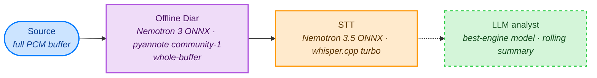
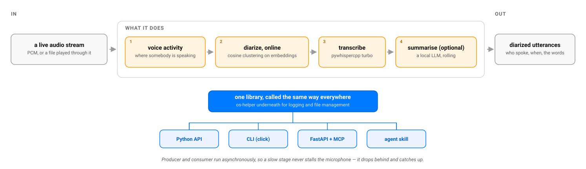

# Vocal Helper

[🇫🇷](https://github.com/warith-harchaoui/vocal-helper/blob/main/LISEZMOI.md) · [🇬🇧](https://github.com/warith-harchaoui/vocal-helper/blob/main/README.md)

[](https://github.com/warith-harchaoui/vocal-helper/actions/workflows/ci.yml)
[](https://github.com/warith-harchaoui/vocal-helper/blob/main/LICENSE)
[](#)
[](https://github.com/astral-sh/ruff)
[](https://github.com/warith-harchaoui/vocal-helper/blob/main/.github/PULL_REQUEST_TEMPLATE.md)
[](#the-promise)


[](https://deraison.ai/ai-helpers)

`Vocal Helper` belongs to a collection of libraries called `AI Helpers` developed for building Artificial Intelligence.

[🌍 AI Helpers](https://deraison.ai/ai-helpers)

## The Promise

**Local-first by design.** vocal-helper runs entirely on your machine. Three stages, all local:

- **transcription** — turning speech into text (Nemotron 3.5 in ONNX when the language is to be discovered, whisper.cpp when it is given);
- **diarization** — working out which of possibly several speakers said each part, labelling them `S0`, `S1`, and so on (Nemotron 3 in ONNX by default, pyannote / NeMo / sherpa-onnx on request);
- **summarisation** — an optional rolling summary (a local Ollama model).

Your audio and transcripts are never uploaded to a third-party service: no telemetry, no account, no cloud lock-in. The paid hosted modes (Gladia or ElevenLabs Scribe for the words, pyannoteAI for the speakers, through the `[cloud]` extra) exist for whoever asks for them by name with a key; without a key they are unavailable, and the router never picks one.

That matters more here than almost anywhere else in the suite. Your voice, and everyone else's on the recording, is among the most personal data there is, and a transcript is a verbatim record of what was said and by whom. Keeping both on your own hardware is what makes this tool safe to point at a real meeting, interview, or therapy session.

Part of the [AI Helpers](https://github.com/warith-harchaoui/ai-helpers) suite: sovereignty over your data through local-first Open Source.

Vocal Helper turns audio into diarized, transcribed utterances, with an optional rolling Large Language Model (LLM) summary of the conversation.

Internally it is a **producer/consumer pipeline**. Each processing step — detecting speech, identifying the speaker, transcribing, summarising — runs as its own worker, and each worker hands its output to the next one down a queue. Think of a bakery: the dough moves from the mixer to the oven to the cooling rack, every station working on a different batch at the same time instead of waiting idle for the whole order to finish.

Two paths ship:

- **Online** (`voh.Pipeline`): live Pulse-Code Modulation (PCM) stream → live transcript + live summary. Each stage runs at its own cadence, decoupled by bounded queues. The Speech-to-Text (STT) stage warms up on start so the first caption doesn't stall on whisper's cold inference.
  - **Diarization** defaults to Nemotron 3 Diarization through its ONNX graph — torch-free, no HuggingFace, weights in the diarization-engines bundle — falling back to a growing-buffer re-diarization when that graph is not installed. See [Live diarization: what changed and why](#live-diarization-what-changed-and-why).
- **Offline** (`voh.OfflinePipeline`): full audio buffer → highest-quality diarization → full-throttle batched transcript → summary.
  - **Diarization** runs over the whole meeting in one call: Nemotron 3 ONNX when its graph is in the bundle, otherwise pyannote community-1 / NeMo Sortformer / sherpa in that order of measured quality (`backend="auto"`). The 2026-07-14 offline map-reduce study found whole-buffer strictly best for Diarization Error Rate (DER); chunk-and-stitch survives only as a memory backstop past ~1 h.
  - **Transcription** goes to the engine `asr={"engine": "auto"}` picks (see the STT row below). On the whisper path it concatenates consecutive segments into ≤ 24 s calls: ~6.5× lower Real-Time Factor (RTF) at a better Word Error Rate (WER), per the 2026-07-09 sweep. Opt back into per-segment Automatic Speech Recognition (ASR) with `OfflinePipelineConfig(asr={"batch": False})`.

Vocal Helper ships on [PyPI](https://pypi.org/project/vocal-helper/) under semantic-versioned tags (currently `v4.0.0`); continuous integration (CI, an automated pipeline that runs the test suite and the linter on every push) stays green on `main` before any tag goes out.

It sits at the top of the AI Helpers dependency graph — the suite's most feature-complete and heaviest package — and builds on five siblings:

| Sibling | What it provides here |
|---|---|
| [os-helper](https://github.com/warith-harchaoui/os-helper) | shared logging and file management |
| [best-engine-ai-helper](https://github.com/warith-harchaoui/best-engine-ai-helper) | the language-model routing described below |
| [audio-helper](https://github.com/warith-harchaoui/audio-helper) | format-agnostic decoding |
| [capture-helper](https://github.com/warith-harchaoui/capture-helper) | the live microphone source |
| [podcast-helper](https://github.com/warith-harchaoui/podcast-helper) | any URL a browser could open |

Each of those five has to work correctly for a single transcript to come out right, which makes this package the suite's most demanding integration test in daily use.

## Documentation

[💻 Documentation](https://deraison.ai/ai-helpers/docs/vocal-helper-doc/)

[🗺️ Landscape](https://github.com/warith-harchaoui/vocal-helper/blob/main/LANDSCAPE.md)

[📋 Examples](https://github.com/warith-harchaoui/vocal-helper/blob/main/EXAMPLES.md)

## Pipelines

Every edge is a bounded `asyncio.Queue` ; every stage is its own
coroutine. Colours follow the
[AI Helpers palette](https://deraison.ai/colors/).

### Online (streaming)


The dashed edge marks the analyst as optional (`llm=None` disables it).

### Offline (batch)



No Voice Activity Detection (VAD) in the offline path: the diarizer consumes the whole buffer
and does its own segmentation.

| Stage | Backend | Notes |
|---|---|---|
| **VAD** *(online only)* | Silero v5 ONNX (Central Processing Unit, CPU) | 32 ms window, `activity_threshold=0.5`, default `min_silence_ms=300`. |
| **Online diarization** | Nemotron 3 ONNX when its graph is in the bundle, else the growing-buffer re-diarization over the per-segment clusterer (see [Live diarization](#live-diarization-what-changed-and-why)). The clusterer's embedder: `nvidia/titanet_large` (NeMo), `pyannote/embedding`, or `sherpa` (torch-free ONNX TitaNet), `backend="auto"` taking the best one installed | The per-segment clusterer: embedding + cosine-distance running-mean clustering, `join_threshold=0.50`. Raised from 0.30 to **0.50** once TitaNet became the default embedder: it sits on a different cosine scale, and an 8-meeting AMI replay found 0.30 inventing 87 speakers where there were 4, against 28 at 0.50, with median confusion 0.234 against 0.095. Default backend switched to NeMo by the 2026-06-30 embedding sweep (`studies/diar_embedding_backend.py`): TitaNet has **+76 % separability margin** (inter − intra median cosine = 0.354 vs pyannote 0.201) on AMI dev-slice, at 7× per-call latency (45 ms vs 6 ms, still negligible per voiced segment). Pass `backend='pyannote'` to skip the ~ 5 GB NeMo install, or `backend='sherpa'` for the torch-free path that a bare install already carries. |
| **Offline diarization** | `nemotron` (Nemotron 3 ONNX, torch-free, default when its graph is in the bundle), `pyannote` **community-1**, `nvidia/diar_sortformer_v1` (NeMo), or `sherpa` (torch-free) | `backend="auto"` takes the first installed in `OFFLINE_PREFERENCE` (nemotron, pyannote, nemo, sherpa). Whole-buffer call. Inputs longer than `ideal_duration_s` (**3600 s** for pyannote, effectively whole-buffer, chunking is a memory backstop only; **60 s** for NeMo, forced by its Sortformer 90 s cap) are auto-chunked with 10 s overlap and stitched by cosine AHC at `stitch_threshold=0.35`. The 2026-07-14 offline map-reduce study found whole-buffer strictly best for DER (0.143 vs 0.170 at 300 s). `sherpa` clusters the whole buffer internally, so `stitch_threshold` has no effect on it; its clustering is tuned instead by `sherpa_cluster_threshold` (default `0.5`, from clean AMI) and `sherpa_num_clusters` (default `-1` auto), both exposed since **v0.7.0**. The `0.5` default over-segments noisy 2-party telephony into dozens of speakers, so set `sherpa_num_clusters=2` when the count is known (see `doc/studies/diar-study.md` §12 in `pasdebonneoudemauvaisesituation`). **Which backend is picked is decided by the [router](#backend-router-the-aiguilleur) below.** |
| **STT** | `engine="auto"` (default): **Nemotron 3.5** (encoder + CTC head in ONNX, numpy host, no torch) when the language is to be discovered; [`pywhispercpp`](https://github.com/abdeladim-s/pywhispercpp) turbo as soon as a `language`, an `initial_prompt` or a non-default whisper `model` is given (`voh.pipeline.choose_asr_engine`) | Word error rate, Nemotron int8 against whisper `auto`, offline: AMI 0.23 / 0.38, overlapped mixes 0.38 / 0.54, Common Voice French 0.27 / 0.69; live, segment by segment, French TV 0.48 / 0.83. Told the language, whisper wins on French TV and on read English, hence the rule. The Nemotron int8 graph (669 MB) downloads once from `deraison.ai/nemotron-onnx` against a pinned sha256 (`VH_NEMOTRON_ASR_URL` for a mirror, `VH_NEMOTRON_ASR_GRAPH` for a local file). `engine="whisper"` / `--asr-engine whisper` restores the old path. On whisper: `large-v3-turbo-q5_0` by default, and with `language="auto"` the language is detected on 30 s from the middle of the buffer before whisper runs. Word timestamps on. Runs in a thread pool so the event loop never stalls. **Strongly recommended: supply `initial_prompt` (domain bias)**, cuts WER 15-25 pp and saves up to 39 % RTF per the 2026-06-30 sweep (`studies/whisper_prompt_lang_lock.py`). |
| **LLM analyst** *(runtime-optional: pass `llm=None` to disable)* | Model resolved via **best-engine-ai-helper** from the committed `vocal_helper/llm.brief.yaml`, served over Ollama or vLLM | Rolling summary of everything **older than 60 s**. The recent 60 s window is kept verbatim. Summary refreshes every **60 s of evicted content** (`flush_every_s=60`). No model tag is hard-coded here: `best-engine-ai-helper` resolves the brief into a machine-specific `llm.engine.yaml` (gitignored) naming the backend + model, and the stage routes every request through `best_engine_ai_helper.llm.chat`. The historical 2026-06-30 7-model Pareto sweep (`studies/llm_model_size_sweep.py`), which surfaced small low-RTF models like `gemma3:4b` / `qwen2.5:3b` and `gemma4:12b-mlx` for offline quality, now informs the brief's `min_tps` / `headroom` knobs rather than a pinned tag. |

## Backend router: the *aiguilleur*

Diarization is the one stage with a real backend fork — several competing implementations, each better in some cases — and there is **no single winner**: the best backend depends on the scenario.

### Live diarization: what changed and why

Until `2026-11-01` the live default was the per-segment online clusterer alone. The argument was sound — a conversational agent wants a label in half a second and cannot un-say one — but the number was not: on AMI dev-slice, eight meetings of four speakers each, that stage measures **0.369 DER with sixty-five labels for four speakers**. A nearest-centroid clusterer has no mechanism for holding an identity across an hour, and no threshold fixes it: four parameterisations were tried and refuted (absolute, fraction of the median inter-speaker distance, fraction of a low quantile, position between the intra- and inter-speaker scales). The optimum moved from recording to recording, and normalising **widened** the spread rather than narrowing it.

Two replacements now ship, and the pipeline picks between them:

| | DER | labels (truth: 4) | latency | needs |
|---|---:|---:|---|---|
| online clusterer *(the old default)* | 0.369 | 65 | ~0.5 s | nothing |
| growing-buffer re-diarization | **0.176** | 4 | minutes, then exact | nothing |
| Nemotron 3 ONNX | **0.090 – 0.252** | 4 | 1.04 s by default (see below) | its graph, from the bundle or fetched once on its own |

**Growing buffer** (`voh.GrowingBufferDiarStage`) keeps the fast provisional label and periodically re-diarizes *everything heard so far*. Because the last pass sees the whole session, its final answer **is** the full-file answer — 0.176 median on those same eight meetings, to the third decimal. Passes are spaced geometrically, so the cost stays proportional to the session rather than to its square: 2.6–3.3× the audio, RTF 0.10–0.16. What it costs is not quality but **freshness**, and `on_revision` says so out loud rather than rewriting history in silence.

**Nemotron 3** (`voh.NemotronOnnxDiar`) is end-to-end: it carries its own arrival-ordered speaker cache, so identity is *learned* instead of arbitrated by a cosine threshold — which is, in hindsight, exactly why those four threshold parameterisations failed. Measured on a synthetic mix whose ground truth is exact by construction, anechoic then reverberated at 0.3 s and 0.6 s RT60: **0.090 / 0.105 / 0.252 DER** against pyannote's 0.299 / 0.296 / 0.553. Two to three times better in every room, the right speaker count everywhere, and speaker confusion of 0.000 on clean speech.

Two honest caveats. On AMI it looks far worse (0.363–0.487) because it emits only 616 s of the 815 s annotated — but AMI's reference is transcribed from the **headset** microphones while the model is given the room mix, so the reference marks words the signal does not carry, and pyannote has AMI in its training data. Three candidate explanations for that missed speech were tested and rejected: the extraction threshold (0.05 recovers almost nothing), the signal level (a 2.8× gain makes it slightly *worse*), and reverberation (Nemotron's missed detection stays flat at 0.090/0.093/0.101 across rooms). Only the annotation is left. And the evidence favouring Nemotron is all synthetic: the one real corpus available is the one whose annotation is the problem.

**Latency is one knob, not a choice of engine.** `PipelineConfig(diar_latency_s=…)` takes seconds; the schedule follows. The default is **1.04 s**, the published low-latency schedule, the same as `NemotronOnnxDiar` built on its own. A meeting room reverberates, and that decides it: at 0.6 s RT60, 1.04 s gives 0.252 error against 0.350 for the longest viable context (6.4 s), and speaker agreement beyond 300 s of 0.668 against 0.372. A long context sees more signal, but signal the room has smeared.

`diar_latency_s=None` takes that longest context, 6.4 s. In an anechoic room it is as good and *cheaper* (a real-time factor of 0.166 against 0.258, for 0.092 error against 0.090): the choice for a clean close-mic recording. `0.32` is the shortest schedule, for a conversational agent such as `discussion-helper`, which answers in the moment and can never un-say a label. Every setting can afford it — what matters live is the **total** real-time factor across stages, not one stage's latency, and the budget holds either way:

| diarization | ASR | total RTF | headroom |
|---|---|---:|---:|
| 6.4 s context | Metal | 0.176 | 5.7× |
| 6.4 s context | CPU only | 0.340 | 2.9× |
| 1.04 s *(default)* | Metal | 0.268 | 3.7× |
| 1.04 s | CPU only | 0.432 | 2.3× |

The ceiling on context is not the one you would guess. The graph accepts 625 frames for `[cache | fifo | chunk]`, which would allow 25.7 s — but the cache update adds `chunk_len` frames to the fifo and removes only `fifo_len`, so a chunk longer than the fifo makes it grow without bound: at 281 frames of chunk the fifo reaches 241 instead of 40 and the sequence hits 826. That is a faithful port of the reference, whose rule only holds when the chunk does not exceed the fifo — its three published streaming schedules respect that (9, 6, 3 frames) and its *offline* schedule, at 340, violates it. Which is exactly why that offline schedule does not work in this export.

`growing=None` restores the pre-2026-11-01 behaviour for a caller that can never revise a label.

`vocal_helper.router` (`voh.select_diarization`) plays the role of an *aiguilleur*, French for the railway signalman who switches each train onto the right track before it arrives. It reads three things about the job:

- how **long** it is;
- whether it runs **live or batch**;
- how many **speakers** there are.

It turns that measured trade-off into one explicit, tested decision, so neither the CLI nor your own code ever hard-codes a backend. And it reports **both quality (DER) and speed (RTF)** for the scenario, not just a name.

The numbers below were **re-validated on-machine** against ground truth — `studies/router_profile_validation.py`, `pyannote.metrics` at collar 0.25, median DER and RTF, over bagarre (30 short mixes) plus the AMI dev-slice, with `sherpa` from ADR 0002. Read them as: **DER** is quality (lower is better), **RTF** is speed (below `1` is faster than real time).

| Mode | Scenario | Backend | DER (quality) | RTF (speed) | Why |
|---|---|---|---|---|---|
| offline | the Nemotron graph is in the bundle (any length, any speaker count) | **`nemotron`** | **0.090** / 0.252 reverberated | 0.258 | End-to-end, torch-free, right speaker count; exact-truth synthetic mix (`studies/diar_far_field.py`), see the caveats above. Checked first, when the CLI or `POST /pipeline` probes it (`nemotron_available=True`). |
| offline | short ≤ 300 s, ≤ 4 speakers | **`nemo`** | **0.142** | 0.051 | End-to-end slot attribution, confusion ~0; ~2.3× better than pyannote on short dense turns (0.330). |
| offline | long / unknown / > 4 speakers | **`pyannote`** | **0.122** | 0.067 | Robust default, AMI median inside Bredin 2023's band; NeMo hangs past ~25 min, caps at 4 speakers. |
| offline | torch-free (no PyTorch) | **`sherpa`** | 0.174 / 0.148 | 0.58 | ONNX TitaNet-large, beats NeMo Sortformer 0.267, FR+EN validated (ADR 0002). |
| online | any live stream | **`nemo`** | 0.586 | 0.030 | Best online embedder at every length (beats online pyannote 0.590/0.844). Online is a latency-bound ~3–4×-offline approximation; `refine_on_close` helps long meetings. |
| online | torch-free | **`sherpa`** | 0.174 | 0.58 | Periodic offline re-diarization (per-segment online sherpa is a dead end, ADR 0002). |

Two findings, both measured here: without the Nemotron graph, **offline** has a real length crossover (nemo
short ↔ pyannote long), so it needs a router; **online** has none, since vocal-helper's
streaming clusterer is a latency-bound approximation where nemo wins at every
length, so streaming always routes to nemo. That online row picks the
per-segment clusterer's embedder only: `Pipeline` then swaps Nemotron in when its
graph is in the bundle, and wraps the clusterer in the growing-buffer
re-diarization when it is not. `voh.select_diarization(live=…,
duration_s=…, max_speakers=…, torch_free=…, pyannote_available=…, nemotron_available=…)` returns a
`BackendPlan(mode, backend, expected_der, expected_rtf, reason)`; the
quality/speed numbers are first-class fields and the `reason` carries the
citation, so a choice is never a black box.

```python
import vocal_helper as voh

plan = voh.select_diarization(live=False, duration_s=45.0, max_speakers=3)
print(plan.backend, plan.expected_der, plan.expected_rtf)  # nemo 0.142 0.051, short, ≤4 speakers
print(voh.select_diarization(live=False, duration_s=1800.0).backend)  # 'pyannote', long form
```

The router is **enforced, not advisory**: `--diar-backend` defaults to **`auto`**
on the CLI and on `POST /pipeline`, so the bundle and the file's real duration are probed
and routed (`nemotron` when its graph is there, else short → `nemo`, long → `pyannote`)
without you choosing. Pass an explicit `nemotron` / `pyannote` / `nemo` / `sherpa` to override.

## How it works



## Installation

> **More recipes?** See [`EXAMPLES.md`](https://github.com/warith-harchaoui/vocal-helper/blob/main/EXAMPLES.md)
> for a self-contained, copy-runnable cookbook of the common workflows
> (live mic, URL replay, offline batch, subscribers, library + CLI usage).

> **Running the heavy stack on a Graphics Processing Unit (GPU)?** See [TECHNICAL_STACK.md](https://github.com/warith-harchaoui/vocal-helper/blob/main/TECHNICAL_STACK.md)
> for the full install recipe : CUDA + PyTorch, whisper.cpp with `GGML_CUDA=on`,
> pyannote 3.1 on MPS/CUDA, local Ollama, expected RTFs per GPU, and a
> reproducible install manifest covering the AI Helpers suite (os-helper,
> audio-helper, podcast-helper, youtube-helper, vocal-helper).

**Prerequisites**: **Python 3.10–3.13** and **git**, **ffmpeg**, **PortAudio**, cross-platform:

- 🍎 **macOS** ([Homebrew](https://brew.sh)): `brew install python git ffmpeg portaudio`
- 🐧 **Ubuntu/Debian**: `sudo apt update && sudo apt install -y python3 python3-pip git ffmpeg portaudio19-dev`
- 🪟 **Windows** (PowerShell): `winget install Python.Python.3.12 Git.Git Gyan.FFmpeg` (PortAudio ships inside the Python wheels)

We recommend using Python environments. Check this link if you're unfamiliar with setting one up: [🥸 Tech tips](https://deraison.ai/4ml/#install).

> **No compiler needed for the base install.** The core (`vocal-helper`, no
> extras) pulls **prebuilt wheels** on every common platform: `pywhispercpp`
> ships wheels for macOS arm64, Linux x86_64/aarch64 and Windows (cp39–cp314),
> so nothing compiles. The heavy pieces are **opt-in**: the `[nemo]` extra brings
> ~5 GB of PyTorch. Two downloads happen on first use instead of at install: the
> diarization-engines bundle (see *Model weights* below) and the 669 MB Nemotron 3.5
> ASR graph. Base install = library + CLIs + ASR/VAD + diarization (sherpa-onnx and
> onnxruntime, torch-free) + LLM analyst.

### From PyPI (recommended)

```bash
pip install 'vocal-helper[all]'
```

### From source (no PyPI)

```bash
git clone https://github.com/warith-harchaoui/vocal-helper.git
cd vocal-helper
pip install -e ".[all]"
```

The `[all]` extra brings the mic and stream sources, the torch diarization backends (NeMo and pyannote), the language-ID cross-check, and the paid cloud clients (switched off until a key is set). Pick à la carte if you don't need everything:

| Extra | Brings | Required when |
|---|---|---|
| (none) | `os-helper>=4.1`, `best-engine-ai-helper`, `audio-helper`, `numpy`, `scipy`, `silero-vad`, `pywhispercpp`, `sherpa-onnx`, `onnxruntime` | File / numpy sources, VAD, both ASR engines (whisper.cpp, Nemotron 3.5 ONNX), torch-free diarization (Nemotron 3 ONNX, sherpa) and the LLM analyst are all part of the base install |
| `[mic]` | `capture-helper` | Live microphone source |
| `[stream]` | `podcast-helper` | URL / stream source (YouTube, Vimeo, Twitch, podcast RSS) |
| `[pyannote]` | `pyannote.audio` | `diar={'backend': 'pyannote'}` (lighter ~500 MB fallback) |
| `[nemo]` | `torch`, `nemo-toolkit[asr]` | `diar={'backend': 'nemo'}`: TitaNet embedder and Sortformer, ~5 GB install |
| `[sherpa]` | nothing any more | kept so `vocal-helper[sherpa]` still resolves: sherpa-onnx is a core dependency now |
| `[cloud]` | `requests`, `websockets`, `pyannoteai`, `wallet-helper` | The paid modes (`voh.CloudOfflinePipeline`, `voh.CloudLivePipeline`, `diar={'backend': 'pyannoteai'}`); each needs its key (`GLADIA_API_KEY`, `ELEVENLABS_API_KEY`, `PYANNOTEAI_API_KEY`, see `voh.credentials_status()`), and `wallet-helper` makes a billed call payable only once |
| `[llm]` | `best-engine-ai-helper` (already a core dependency; this extra just re-lists it for intent) | No separate install needed; the LLM analyst ships in the base install |
| `[lid]` | `speechbrain`, `torchaudio` | `voh.lid.cross_check_regions(...)`, an independent language-ID cross-check |
| `[api]` / `[mcp]` | FastAPI + uvicorn, fastapi-mcp | The HTTP surface and the MCP surface (see the surfaces table below). The CLI needs no extra: `click` is a core dependency |
| `[all]` | Every extra above except `[studies]` | One-line install |

The LLM analyst ships in the base install, but it still needs an engine resolved
once per machine before its serving backend is up. `best-engine-ai-helper` reads the committed
`vocal_helper/llm.brief.yaml`, chooses the backend + model for your hardware
(Ollama on macOS / CPU, vLLM on a discrete GPU), and writes a gitignored
`vocal_helper/llm.engine.yaml`. `voh.resolve_engine()` does this on first use, or run it explicitly:

```bash
# From the vocal_helper package directory (holds llm.brief.yaml):
best-engine-ai-helper resolve --brief llm.brief.yaml --out llm.engine.yaml
# then start the resolved backend, e.g. on macOS:
ollama serve   # the engine file's `serve:` line names the exact `ollama pull …`
```

### Model weights: no HuggingFace needed

All model weights ship in a single self-hosted **diarization-engines
bundle** (the Nemotron 3 diarization graph, offline pyannote community-1 and 3.1,
NeMo Sortformer, the online `pyannote/embedding` embedder, SpeechBrain
VoxLingua107, and the torch-free `sherpa` ONNX, pyannote-3.0 segmentation +
TitaNet). The Nemotron 3.5 ASR graph is the one exception: it downloads on its
own from `deraison.ai/nemotron-onnx`. Point
`vocal-helper` at it once and the whole stack runs **HuggingFace-free**:
no token, no gated downloads, `HF_HUB_OFFLINE=1` safe.

Configure it in `settings.yaml` (the only config the project needs):

```bash
cp settings.yaml.example settings.yaml
# settings.yaml already contains:
#   engines:
#     diarization_url: https://deraison.ai/diarization-engines-slim.zip
# settings.yaml is git-ignored.
```

#### What the URL is

`https://deraison.ai/diarization-engines-slim.zip` is a **self-hosted ZIP**
(~800 MB) that mirrors every gated/hub-hosted model the pipeline needs, so
the project never has to authenticate against HuggingFace. The code reads these
folders from it:

| Folder | Weights | Used by |
|---|---|---|
| `nemotron3/` | `nemotron-3-diarization.onnx` (~400 MB) | diarization, offline and live — the default whenever it is present |
| `pyannote-community-1/` | the community-1 checkpoint folder with its own `config.yaml` | offline diarization — the default the code looks for first |
| `pyannote-3.1/` | segmentation-3.0 + wespeaker `.bin` + a local `config.yaml` | offline diarization — the warned fallback when the configured bundle predates community-1 |
| `nemo-sortformer/` | `diar_sortformer_4spk-v1.nemo` | offline diarization (NeMo) |
| `pyannote-embedding/` | embedding `.bin` | online diarization |
| `sherpa/` | pyannote-3.0 segmentation + TitaNet ONNX | the torch-free `sherpa` backend |
| `speechbrain-voxlingua107/` | ECAPA VoxLingua107 snapshot | language-ID cross-check |
| `manifest.json` | sha256 + sizes | integrity check on download |

**The published ZIP carries neither `nemotron3/` nor `pyannote-community-1/`.**
The Nemotron graph is therefore served on its own, next to the ASR graph:
when the bundle lacks `nemotron3/`, the first use downloads
`https://deraison.ai/nemotron-onnx/nemotron-3-diarization/nemotron-3-diarization.onnx`
once (400 MB, sha256 pinned in `vocal_helper.nemotron.GRAPH_SHA256`) into
`~/.cache/vocal-helper/nemotron-onnx/`, so a cache filled by an older ZIP reaches
the default too. `$VH_NEMOTRON_DIAR_URL` points it at a mirror. pyannote, without
`pyannote-community-1/`, loads 3.1 with a warning.

On first use the ZIP is downloaded once, checked against the sha256 pinned in
`vocal_helper.diar.DEFAULT_DIARIZATION_ENGINES_SHA256` (default URL only), and
cached under `~/.cache/vocal-helper`; later runs load straight from the
cache. Set `$VH_DIARIZATION_ENGINES` to a local directory (or your own
mirror URL) for air-gapped / self-hosted deploys. TitaNet (the default
online-diar embedder) loads from NVIDIA NGC, also without HuggingFace.

## Quick start

Two commands for text, four for text with speakers. The first run of each path
downloads the weights it needs and caches them, so only the first one is slow.

```bash
pip install 'vocal-helper[all]'            # or plain `vocal-helper` for the light core
vocal-helper transcribe clip.wav           # text only: no VAD, no diarization, no config

cp settings.yaml.example settings.yaml     # carries the diarization-engines URL
vocal-helper file meeting.wav --no-real-time   # + speakers; the router picks the backend
```

`transcribe` is the short path because it skips the pipeline entirely. The four
recipes below are the real surface: a live microphone, the Python API, a file
through the streaming pipeline, and a file through the offline one.

### Live microphone → terminal

```bash
# No token, no HuggingFace: weights come from the diarization-engines bundle.
vocal-helper mic --llm
```

### Python API

```python
import asyncio
import vocal_helper as voh


async def main():
    pipeline = voh.Pipeline(
        source=lambda: voh.sources.from_microphone(),
        config=voh.PipelineConfig(
            # No diar backend: Nemotron 3. Naming one ({"backend": "pyannote"}) is honoured.
            asr={"model": "large-v3-turbo-q5_0", "language": "auto"},  # discovered from the audio
            llm={"engine": voh.resolve_engine()},  # remove to disable
        ),
    )
    async for ev in pipeline.run():
        if "text" in ev:
            print(f"[{ev['t0']:.1f} {ev['speaker']}] {ev['text']}")
        elif "summary" in ev:
            print(f"--- rolling summary ---\n{ev['summary']}")


asyncio.run(main())
```

### Replay a WAV through the **online** pipeline

```bash
vocal-helper file path/to/conversation.wav --llm
```

The file source preserves real-time pacing by default ; pass `--no-real-time` for as-fast-as-possible batch processing.

### **Offline** batch on a WAV (whole-buffer pyannote community-1)

```python
import asyncio, vocal_helper as voh


async def main():
    pipeline = voh.OfflinePipeline(
        source=lambda: voh.sources.from_wav_file("meeting.wav", real_time=False),
        config=voh.OfflinePipelineConfig(
            diar={"backend": "pyannote"},  # or "nemo" for ≤ 60 s clips
            asr={"language": "auto"},  # discovered from the audio, no default
            llm={"engine": voh.resolve_engine()},  # remove to disable
        ),
    )
    async for ev in pipeline.run():
        if "text" in ev:
            print(f"[{ev['t0']:.1f} {ev['speaker']}] {ev['text']}")
        elif "summary" in ev:
            print(f"--- digest ---\n{ev['summary']}")


asyncio.run(main())
```

When to use which, and the [router](#backend-router-the-aiguilleur) picks the backend for you:

| Use-case | Pipeline | Backend (router pick) | Why |
|---|---|---|---|
| Live mic / live stream | `Pipeline` | Nemotron 3 ONNX when its graph is in the bundle, else the growing-buffer re-diarization (over the online `nemo` clusterer) | Nemotron: DER 0.090 anechoic, 0.252 reverberated, the right speaker count. The growing buffer: 0.176 on AMI, paid in freshness rather than quality. The per-segment clusterer alone (`growing=None`) is a latency-bound approximation, ~3–4× the offline DER. |
| Meeting / podcast / lecture / voicemail batch | `OfflinePipeline` | `nemotron` when its graph is in the bundle, else `pyannote` community-1 | Whole-audio pyannote is the highest-quality answer: AMI median DER 0.116, inside Bredin 2023's band, and community-1's worst meeting is 0.149 against 3.1's 0.474; NeMo hangs past ~25 min. |
| ≤ 60 s clips, ≤ 4 speakers, fast turn-around | `OfflinePipeline(backend='nemo')` | `nemo` Sortformer | End-to-end attribution, confusion ≈ 0, RTF ≈ 0.004 (250×). |
| On-device / no PyTorch | either, `backend='sherpa'` | `sherpa` ONNX | Torch-free TitaNet-large; DER 0.174/0.148, FR+EN, embeddable anywhere. |

## A toolbox: library, CLI, HTTP, MCP & GUI

`vocal-helper` is a **toolbox**, not an app. It exposes the *same* local pipeline
through coherent surfaces so it composes into your own project without
re-implementing the wiring. Everything runs **locally**: no surface sends audio
to a remote service.

| Surface | Entry point | Extra | Kind of use |
|---|---|---|---|
| Python library | `import vocal_helper as voh` | (none) | Compose the stages into your own app; full typed Application Programming Interface (API). |
| CLI | `vocal-helper` | (none, ships with the base install) | Shell scripts, cron, headless CI, pipes to `jq`; rich `--help`, `-h` / `-V`, shell completion. |
| FastAPI HTTP | `uvicorn vocal_helper.api:app` | `[api]` | A local HTTP surface: upload a file (or pass a `url`), get a transcript / event list; `GET /docs` for the Swagger UI. |
| MCP tools | `vocal-helper-mcp` | `[api,mcp]` | Any Model Context Protocol (MCP)-aware host (agent runtimes, IDEs): publishes `transcribe` + `pipeline` as local first-class tools. |
| Transcript-viewer GUI | `GET /gui` (served by the API) | `[api]` | A build-step-free browser page: drop a file or paste a URL → **speaker colour-coded transcript + rolling summary**. `/` redirects to it. |

```bash
# language is discovered by default ('auto'), pass --language xx only to force one
vocal-helper transcribe clip.wav
vocal-helper file meeting.wav --offline --llm

# local HTTP surface + transcript-viewer GUI (open http://127.0.0.1:8000/gui)
uvicorn vocal_helper.api:app --host 127.0.0.1 --port 8000 &
curl -F 'file=@clip.wav' http://localhost:8000/transcribe        # language auto-discovered
curl -F 'url=https://youtu.be/…' http://localhost:8000/pipeline  # URL fetched locally ([stream])

# MCP surface: the same local app, exposed as agent tools
vocal-helper-mcp
```

### The transcript-viewer GUI (`GET /gui`)

A self-contained single page (HTML + Tailwind CDN + vanilla JS, no build step)
served **same-origin** by the API. Drop an audio file **or paste a URL**, run
diarized transcription locally, and read a **speaker-labelled, colour-coded
transcript** (one stable colour per speaker) alongside the rolling summary. It
POSTs to the same `/pipeline` endpoint (zero extra server logic) and contacts
only the local server, so your audio never leaves the machine. Utterances reveal
progressively (motion-guarded) so a long transcript reads as if it streams in.

The page speaks **French and English**. `GET /gui?lang=fr|en` picks one, a flag in the header toggles between them, and a code no catalogue carries falls back to the default rather than failing.

The English is the source, written in the markup itself. The French lives in [`vocal_helper/locales/fr/LC_MESSAGES/vocal_helper.po`](https://github.com/warith-harchaoui/vocal-helper/blob/main/vocal_helper/locales/fr/LC_MESSAGES/vocal_helper.po), a standard `gettext` catalogue read through `os_helper.Catalog` — the loader shared across the suite — so a translator works in the format every translation tool already speaks, on real sentences rather than on key names.

Edit the `.po`, then recompile with `python -c "import os_helper as osh; osh.compile_catalogs('vocal_helper/locales')"`.

### Use it as an agent skill

`skills/vocal-helper/` packages vocal-helper as a **Claude Skill** *and* an
**OpenCode skill** so an agent can transcribe / diarize / summarise on your
behalf. See [`skills/README.md`](https://github.com/warith-harchaoui/vocal-helper/blob/main/skills/README.md) to install (symlink into
`~/.claude/skills/` and `~/.opencode/skills/`), and
[`TRIGGERS.md`](https://github.com/warith-harchaoui/vocal-helper/blob/main/TRIGGERS.md) for the exhaustive catalogue of what invokes it.

### Public surface added 2026-10-19

`make_embedder(backend)` and `resolve_sherpa_models()` replace the private names three
repositories were importing across a boundary (`_TitaNetEmbedder`, `_SherpaEmbedder`,
`_resolve_sherpa_models`). Both embedder backends emit the same 192-d TitaNet-large
vector, so the choice is installation and platform, never quality: `nemo` through torch,
`sherpa` through onnxruntime for iOS and Android.

## Subscribers: fan-out without owning the loop

Every stage can be observed without consuming the merged output stream :

```python
async def on_voiced(seg):
    print("VAD:", seg["t0"], seg["t1"])


async def on_diar(seg):
    print(" → ", seg["speaker"], seg["t0"], seg["t1"])


pipeline.subscribe_voiced(on_voiced)
pipeline.subscribe_diarized(on_diar)

async for ev in pipeline.run():
    ...
```

Useful for WebSocket / SSE relays, live User Interface (UI) updates, or JSONL persistence.

## Diarization choice: offline and online have different winners

Measured, not assumed, on 2026-10-19.

**Offline — `pyannote community-1`.** On AMI (8 meetings, collar 0, overlap scored) it ties speaker-diarization-3.1 on the median, so a median comparison says there is nothing to choose between them. The difference is all in the tail:

| On AMI | community-1 | speaker-diarization-3.1 |
|---|---|---|
| median DER | 0.116 | 0.116 |
| worst meeting | **0.149** | 0.474 |
| spread | **0.086** | 0.412 |

One meeting carries all of it, and there community-1 is 3.3× better.

On three real 64-minute six-speaker panels it also over-splits least of everything measured — **2.7×**, against 3.0× for 3.1, 3.7× for Sortformer 4spk-v1 and **19.7×** for the sherpa-onnx path.

It is the default for `_PyannoteOfflineDiar`; a bundle that predates it falls back to 3.1 with a warning.

**Online — `diart`.** The opposite verdict, from the measurement `operator-assistance-streaming` had already made:

| On its long reference | diart | community-1 path |
|---|---|---|
| speaker error | **6.04 %** | 11.7 % |
| first label | **500 ms** | 20 s |

`DiartDiarStage` is the port. It costs an environment of its own, and it revises what it already emitted: diart re-sends its whole annotation each step, so `snapshot_to_delta` turns that into a stream and **counts the revisions** — the honest price of the 500 ms. Read that count next to the latency with `LiveMetrics`, never alone.

**Still the default for the built-in online stage — cosine clustering.** The `pdbms` study
(2026-06-29, N=2089 per system) ranks streaming diarizers as `hungarian_nemo` (w=20 s, DER
0.13–0.20) up to 300 s and `hungarian_pyannote` (w=30 s, 0.30–0.45) beyond. `OnlineDiarStage`
specialises that: the VAD already isolates each voiced segment, so the sliding window collapses
to per-segment embedding plus cosine running-mean clustering. `join_threshold` is **0.50**, raised from the
0.30 that was calibrated for `pyannote/embedding` before TitaNet became the
default embedder and moved the cosine scale under it.

## Scoring: `vocal_helper.bench`

Plain WER cannot see how multi-speaker audio actually fails, so the module carries the metrics
that can.

| function | what it sees that the others do not |
|---|---|
| `cpwer` | the right words under the **wrong person**. Concatenate an episode and a diarizer that merged five panellists into two scores exactly like one that separated them; DER sees that and never reads a word. Unmatched speakers are charged on **both** sides, so over-splitting is not rewarded. |
| `term_error_rate` | **which** words were missed. "le Fégaro" for *Le Figaro* is a rounding error in WER and a lost record in any corpus-level analysis. |
| `speaker_label_error` | the product's question — how often is the displayed name wrong — ignoring the boundary slop DER bills to the millisecond. |
| `der_report` | DER **decomposed** (miss / false alarm / confusion have different cures), collar 0 and overlap scored by default, plus JER and both speaker counts. |

## Live sessions: `vocal_helper.live_metrics`

Offline quality has WER and DER; live has latency, flicker and queue wait, and no one of them
is the answer alone.

```python
m = voh.LiveMetrics()
pipeline = voh.Pipeline(source=..., metrics=m)
...
print(m.summary())
```

Latency is counted from the **end** of the speech, because that is when a listener starts
waiting. The revision rate matters because text that jumps is unusable at any word error rate —
and zero revisions is not automatically good, it is paid for in latency. Per-queue waits say
*where* the time went: a slow total with no queue wait is a slow model, the same total with a
large one is a starved consumer. Opposite fixes.

`violations` enforces the one rule the whole live design rests on: **no update appears before
the audio that produced it**. A non-zero count means a clock, a buffer or a mock is lying, and
every number beside it is fiction.

## Failures are loud

A pipeline that lost a stage used to return a normal, **empty** transcript with the reason only
in a log. `run()` now raises `StageCrashed`, naming every stage that died, and
`pipeline.stage_failures` carries the exceptions. Pass `strict=False` to opt back into
leniency — a choice somebody makes rather than inherits.

## Spoken-language identification

Before a word is transcribed, `vocal_helper.lid` decides **which language is
being spoken** for the whole file, or per region of a code-switched
recording. This matters because a plain whisper `"auto"` pass locks onto the
first language it hears and *translates* the rest into it; identifying the
language acoustically **first** lets each region be transcribed in its own
language. It also catches mislabeled data: on a 423-call corpus the acoustic
census overrode the folder labels on 21 files (English and Dutch calls filed
under "FR", etc.).

**Discovery-first: no default language, no pairing.** Detection returns the
language the input *actually is* (whisper's true argmax over its full language
head). There is no default language and no language pair; the language is
discovered from the audio itself.

| Function | What it does |
|---|---|
| `detect_language(pcm)` | One global detection. Returns `(iso_639_1, probability)` for the language whisper actually detected: any language, not a preferred subset. |
| `detect_language_regions(pcm)` | Partitions code-switched audio into mono-language `LangRegion`s via an overlapping-window **posterior curve**: Gaussian-smoothed, boundaries locally refined and snapped to the nearest silence. Empty / too-short audio returns no region rather than guessing one. |
| `detect_language_regions_fast(pcm)` | Fast path *(new in 0.4.2)*: one cheap whole-file detection ; if it clears the confidence gate (`DEFAULT_FAST_CONF_GATE`, 0.5) the file is treated as monolingual (a single region), otherwise it falls back to the full posterior scan. **~73 s → ~1 s per file** on the monolingual majority, identical output. |
| `cross_check_regions(pcm, regions)` | Optional independent verification with SpeechBrain VoxLingua107 (shipped in the diarization-engines bundle): a second, model-diverse opinion on each region's language, reported verbatim. |

```python
import vocal_helper as voh

# Fast path, the right default for batch corpora that are mostly monolingual:
regions = voh.detect_language_regions_fast(pcm, 16_000)
for r in regions:
    print(f"{r.lang}  [{r.t0:.1f}–{r.t1:.1f}s]")
```

**Opt-in routing hint.** If you can only *route* a fixed set of languages, pass
`supported=("en", "fr", "es", "it", "pl", "nl")` to re-rank detection within
that set (so a close but un-routable relative, Galician over Spanish on a short
window, never wins). This is entirely optional: leave it unset (`None`, the
default) and the input speaks for itself.

## Roadmap

Shipped since this list was first written: the `--jsonl` output writer, and the
auto LLM-engine selector (`voh.resolve_engine()`, landed in `2.0.0`). What's
still open:

- `SemanticEOTStage` enabled by default, once the 2026-06-30 EOT study's
  false-cut reduction on AMI is confirmed at scale (LiveKit-style; see
  `studies/eot_semantic_vs_silero.py`). It ships today behind the opt-in
  `--eot` flag.
- A standard WebSocket relay for the online pipeline. The FastAPI surface
  (`vocal_helper.api`) intentionally stays offline-only; a WebSocket surface
  for the streaming path is planned but lives outside this package for now.
- Language-locked Whisper rejection for ASR hallucinations on silence.
- Out of scope by design: speaker ID anchoring via pre-enrolled voiceprints,
  excluded by the user's industrial deployment compliance constraints. IDs
  stay anonymous (`S0`, `S1`, …) within a session.
- Replace the in-stage `_PyannoteEmbedder` with the overlap-aware variant from
  `pdbms.diar.backends.pyannote.embed_overlap_aware` for noisy mixes.
- Pipecat-style typed Frame events with a `SystemFrame` priority queue in the
  production pipeline itself (clean shutdown, out-of-band control signals that
  bypass the data queues). `vocal_helper.parallel_pipelines` already ports
  Pipecat's fan-out primitive, but only for study scripts under `studies/`,
  not for `Pipeline`/`OfflinePipeline`.

## Versioning & stability

`vocal-helper` reached its first stable release at `1.0.0` and is currently at
`4.x`, following [Semantic Versioning](https://semver.org):

- **The public API** is the names exported from `vocal_helper.__all__` plus the
  documented CLI flags. That's what stability promises apply to.
- **Breaking behaviour and default changes land only in MAJOR releases**
  (`1.x` → `2.0.0`). A **MINOR** release adds features compatibly; a **PATCH**
  is bug-fixes and docs only, it will never change a default under you.
- Three MAJORs have shipped since `1.0.0`, all for a changed default rather than a removed name.
  - `2.0.0` replaced the hard-coded LLM model tag with a per-machine engine resolved from a committed brief, which changed the analyst's CLI/API surface.
  - `3.0.0` made a run that lost a stage raise `StageCrashed` instead of returning an empty transcript, and moved the offline pyannote checkpoint to community-1. `strict=False` restores the lenient behaviour; the checkpoint has no public knob — a bundle that predates community-1 falls back to 3.1 with a warning.
  - `4.0.0` made the measured best engines the defaults: Nemotron 3.5 for transcription when the language is to be discovered, Nemotron 3 for diarization whenever its graph is in the bundle (the growing-buffer re-diarization live when it is not), and `backend="auto"` on both diarization stages. `asr={"engine": "whisper"}`, an explicit offline `diar` backend and `growing=None` restore the 3.x paths.
- Deprecations get a release with a warning before removal.

## Author

[Warith HARCHAOUI](https://linkedin.com/in/warith-harchaoui), `warithmetics@deraison.ai`

## Acknowledgements

Special thanks to
[Mohamed Chelali](https://mchelali.github.io),
[Bachir Zerroug](https://www.linkedin.com/in/bachirzerroug)
and
[Edmond Jacoupeau](https://www.crunchbase.com/person/edmond-jacoupeau).

## License

This project is licensed under the BSD-3-Clause License: see the [LICENSE](https://github.com/warith-harchaoui/vocal-helper/blob/main/LICENSE) file for details.
